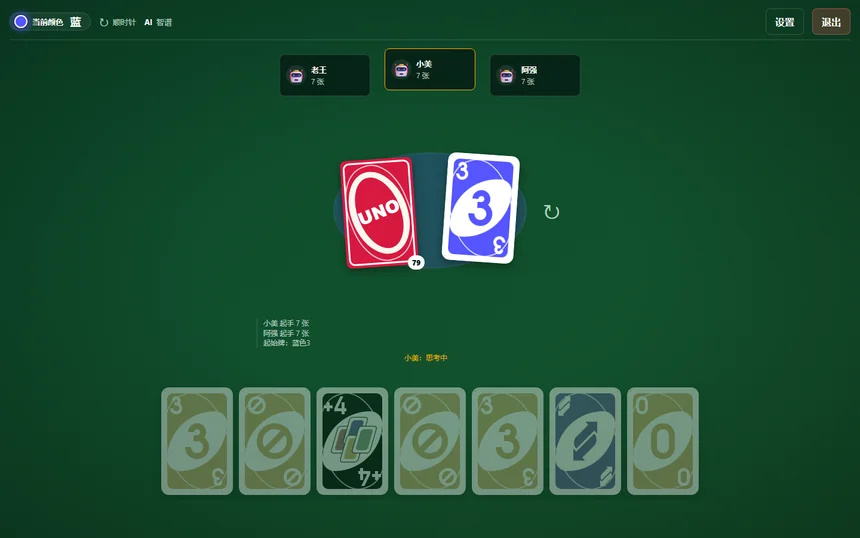
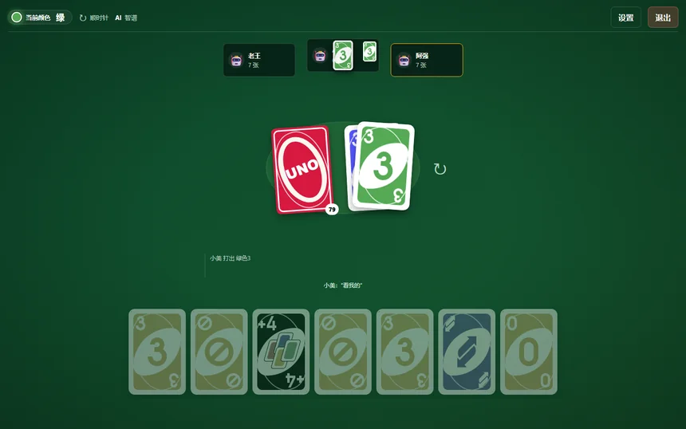
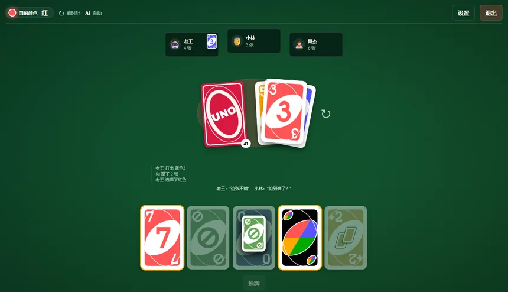

# UNO · 桌面版与本地网页游戏


[](https://github.com/shark-syh/uno-personal-game/actions/workflows/ci.yml)
[](https://github.com/shark-syh/uno-personal-game/releases/tag/v1.3)


> 一张牌桌，108 张牌，一个你，和 2~9 个 AI。
>
> 不用登录，不用联网，也没有分数——只有下一张牌，和谁先喊出那句 UNO。

这是一个可以在本地安静打完一局的 UNO。**Windows 桌面版**下载安装即可启动，内置服务，不需要另装 Node.js；也可以用 `npm install` + `npm run dev` 在浏览器里打开 `http://localhost:3000`。剩下的事，交给洗牌和 AI。

它也不是一个「演示」：完整规则引擎、四档本地 AI、可选的大模型决策、6~10 人牌桌、动效与音效、设置与战绩，都在这里。断网时，本地 AI 仍然会认真出牌；接入智谱之后，牌友会多一层「思考」，偶尔还会说一句台词。桌面版还支持同一局域网内的朋友通过「附近房间」或房间码加入。

规则大体照着原版，但有几处按手感做了取舍。它们被写进文档、做成了设置项，也都有测试兜底——下文会慢慢讲到。

**当前版本：v1.3.0**（2026-10-21，桌面安装版）· 仓库：<https://github.com/shark-syh/uno-personal-game> · 变更摘要见 [CHANGELOG.md](CHANGELOG.md)。

<p align="center">
  <a href="https://github.com/shark-syh/uno-personal-game/releases/tag/v1.3"></a>
  <a href="https://github.com/shark-syh/uno-personal-game/archive/refs/tags/v1.3.zip"></a>
</p>

## 下载与安装

| 文件 | 说明 |
| --- | --- |
| [`UNO-Setup-1.3.0.exe`](https://github.com/shark-syh/uno-personal-game/releases/download/v1.3/UNO-Setup-1.3.0.exe) | Windows 10/11 x64 安装包（约 107 MiB），当前用户安装，无需管理员 |
| [源码 zip](https://github.com/shark-syh/uno-personal-game/archive/refs/tags/v1.3.zip) / [tar.gz](https://github.com/shark-syh/uno-personal-game/archive/refs/tags/v1.3.tar.gz) | v1.3 完整源码，与安装包同一 Release |
| [`SHA256SUMS.txt`](https://github.com/shark-syh/uno-personal-game/releases/download/v1.3/SHA256SUMS.txt) | 安装包校验值 |

安装包 SHA256：`B14FBB835DAF81E66BF692DC7F9AD041581FC1425D17CCFB493A9A5633B61A6E`。安装后双击 **UNO** 即可启动；首次开房时 Windows 会询问防火墙权限，允许后同一局域网的朋友才能发现房间。安装包未做代码签名，SmartScreen 可能提示「更多信息 → 仍要运行」。

<p align="center">
  
</p>

<p align="center"><em>一局 4 人对局的牌桌：左边是 AI，中间是牌堆，下方是你的手牌。</em></p>

**目录**：[下载](#下载与安装) · [一局是怎样的](#一局是怎样的) · [牌友](#牌友四档-ai-与智谱) · [规则](#让牌局有性格的规则) · [胜利之后](#胜利之后) · [动效与音效](#动效音效与设置) · [多人与小屏](#多人与小屏) · [局域网联机](#局域网联机) · [快速开始](#快速开始) · [智谱配置](#ai-模式与智谱配置) · [命令](#常用命令) · [架构](#技术架构) · [FAQ](#常见问题) · [版本](#版本与更新) · [免责声明](#免责声明)

## 一局是怎样的

从大厅开始。选人数，选难度，决定 AI 是「智谱」「本地」还是「自动」，再决定要不要打开 +4 挑战。点下「开始游戏」，发牌动画从牌堆飞向每个座位，然后轮到牌桌上的某一个人。

<p align="center">
  
</p>

<p align="center"><em>大厅：人数、难度、AI 模式、+4 挑战，都从这里开始。</em></p>

轮到你的时候，可出的牌会亮起来。点一下手牌就是出牌；没有能出的牌，就点「摸牌」。摸牌不是摸一张就停——你会一直摸，直到摸到一张能打的牌为止，中途摸到的牌都留在手里。这个改动让牌局变长了，但也让「摸到能打的那张」多了一点小小的期待。

出完牌后，AI 会短暂思考。接入智谱后，它们偶尔会留下一句话，台词只停 2.6 秒，随后消失；轮到下一位时，上一位的话不会再留在桌上。牌堆、颜色、方向、UNO 窗口、叠牌累计数，都在属于它们的位置上。

一局结束得很快，也可能很慢。有人出完手牌，或者牌堆见底，游戏就停。没有下一关，也没有必须完成的日常。想再来一局，点一下就行。

## 牌友：四档 AI 与智谱



AI 不是陪练，也不是一个只会「能出就出」的脚本。它们分四档：休闲、简单、真实、骨灰级。档位会改变记牌、留牌、叠牌、挑战与抓 UNO 的选择，也会改变「思考」的时长。同一手牌，交给不同档位的 AI，得到的下一步可能完全不同。

本地 AI 完全离线。它生成候选、给牌打分、记住已经出现过的牌，然后从合法动作里挑一个——通常只需要几毫秒。没有网络、没有 Key、没有额度，它也能把一局牌打完。

<p align="center">
  
</p>

<p align="center"><em>在线模式下，AI 会在思考后留一句话，但不会让上一句台词留在桌上。</em></p>

接入智谱之后，流程多了一步：把公开信息和自己的手牌整理成候选，交给模型选择，再回到本地校验。模型选错了、超时了、额度用完了，都自动降级回本地 AI——牌局不会因此停下。真实/骨灰级每个回合都尝试在线决策，休闲与简单则按比例参与。

在线决策会慢一些：思考型模型单次大约 3~4 秒。为此，下一步的请求会在上一步动画播放时提前发出；动画结束，回答往往已经在路上。状态栏悬停可以看到最近一次决策的模型与耗时。想要即时响应，把 AI 切成「本地」即可。

## 让牌局有性格的规则


这个项目最核心的差异是**宽松叠牌**：+2 可以压 +2，+4 可以压 +2，反过来也可以。叠牌链累计的摸牌数会一直长下去，直到有人选择放弃，然后把那一摞数字一次性摸走。颜色规则在叠牌阶段被暂时放下，胜负常常因此翻转。

另一处是 **+4 挑战**。被 +4 指向的人可以选择摸 4 张，也可以挑战查看对方手牌。人类挑战 AI 时，对方的手牌会完整展示 2.6 秒；AI 挑战人类时，只留一句「XX 查看了你的手牌」。这不只是为了公平，也让「他到底有没有赖」变成一个可以看、可以赌的瞬间。

如果你在 2 人桌上打开「2 人特殊规则」，Reverse 会变成 Skip，Skip 和动作牌会带来连动——刚出完牌的人可能立刻又轮到自己。这个开关可以关掉，关掉后就回到多人桌的轮转方式。

其余规则差异都放在一张表里，方便快速对照：

| 项目 | 本作默认 | 说明 |
| --- | --- | --- |
| 叠牌 | **宽松叠牌** | +2 / +4 可任意互叠（不看颜色），累计摸牌；叠牌链中的 +4 不开放挑战 |
| 主动摸牌 | **摸到能打出的牌为止** | 一次摸牌可能摸多张，过程牌进手牌；停下的牌只能打出或结束回合（官方为摸 1 张） |
| 起手动作牌 | 照常生效 | 可切「忽略动作牌，继续翻牌」 |
| 牌堆耗尽 | 洗回弃牌堆 | 可切「耗尽即结束（手牌最少者胜）」，并列最少为平局 |
| +4 判定 | 经典口径 | 手上有当前颜色牌时出 +4 属违规；「Wild 也算匹配」保留为引擎配置 |
| 2 人规则 | 开启 | Reverse 等同 Skip、连动；可关闭 |
| UNO 罚牌 | 2 张 | 设置页可选 1/2/3 张 |
| +4 挑战 | 开启 | 大厅可关闭；关闭后 +4 直接摸 4 张 |
| 计分 | **无分数** | 结算页只展示最终结算与操作统计图表 |

完整规则规格见 [`docs/开发计划.md`](docs/开发计划.md) 第 2 章；关键规则决策表在 §2.8。

## 胜利之后


有人出完最后一张牌，屏幕会切到结算页。这里没有分数，也没有「本局得分」——这是这个项目一个刻意的决定。

我们更想让你看到这一局发生了什么：每个人出了几次牌、摸了几张、叠了几次；全体动作如何构成；大家手里剩下的牌是什么颜色。赢了，结算行会写「出完手牌」；牌堆耗尽时，则写「手牌最少获胜」。平局就是平局，没有赢家行。

图表是纯 CSS 画的，不依赖任何图表库。数字来自引擎对整局事件历史的统计，而不是 UI 自己算的。

## 动效、音效与设置



发牌、出牌、摸牌、跳过、反转、叠牌、挑战、UNO、洗牌、结算彩带——15 类事件动效由事件队列串行播放。动效只改 `transform` 和 `opacity`，10 人桌上也不会堆出几十个同时飞行的元素；队列结束时，临时元素与定时器会被清理干净。

音效是现场合成的：16 类事件音，全部由 WebAudio 的振荡器和噪声拼出来，没有外部音频素材。浏览器不允许自动播放，所以第一次点击/按键之后才解锁声音。音效可以单独关闭，也可以调「低 / 中 / 高」三档音量。

设置页里有动画开关与「正常 / 快速」两档速度；`?slow=1` 可以把动画整体放慢，方便观察。系统开启「减少动态效果」时，动效会被跳过，但挑战时对方手牌仍然会以静态方式展示——该看到的信息不会因为动效关闭而消失。

<p align="center">
  
</p>

<p align="center"><em>设置页：动效、音效、AI 速度，以及 4 项规则开关。</em></p>

## 多人与小屏


最多 10 个座位。人一多，牌桌就变成另一种东西：一圈头像，此起彼伏的「思考中」，还有你几乎记不过来的出牌速度。10 人真实对局在 1440 与 1024 宽度下都不会重叠、溢出；每个座位都在自己的位置上，手牌数、UNO 状态和最近出的牌都能看见。

小屏幕也能玩。760 宽度下，座位会折成网格，手牌区允许横向滚动；布局不横向溢出，操作栏仍然可用。移动端目前是基础适配，还没有做真机验收——桌面仍是主要场景。

<p align="center">
  
</p>

<p align="center"><em>760 宽度：座位折行、手牌横向滚动，功能不缺席。</em></p>

## 局域网联机

v1.1 起，牌桌可以分给同一局域网里的朋友。一台电脑开服务（双击 `启动服务.bat`，或 `npm start`），其他设备打开它打印的局域网地址（如 `http://192.168.x.x:3000`），输入 6 位房间码就坐到了同一张桌上。

进房后可以改自己的名字；房主可以给空位补上 0~9 个 AI——一个人也能先开一局。对局由服务端统一裁决：每个人只看到自己的手牌，别人摸了几张能数、但看不到牌面；掉线了会自动重连坐回原位，刷新页面也能静默恢复；实在回不来，服务端 AI 会替你顶着。一局结束，房主点「再来一局」，原班人马直接重开。

v1.2 起，牌桌上多了「表情」：大厅等待或对局中点表情按钮，可向其他玩家发 12 个预置 emoji，气泡出现在发送者的座位框下方；每座位连发 5 条后冷却 2 秒（服务端权威限频）。

v1.3 起，桌面版会自动发现同一局域网内的开放房间：在「附近房间」点击即可加入，也可以输入房间码；UDP 广播被防火墙拦截时仍可手动填写 `IP:端口`。连接有 8 秒握手超时，加入被拒会立即回到大厅。房主断线或离开时，房主自动移交给下一位在线玩家，对局可以继续；主机正常关闭窗口时会广播关闭通知，远程玩家立即回到单机大厅。

> 联机模式的 AI 固定为本地启发式（智谱在线决策暂未接入联机）；房间只存在于服务器进程内存，服务重启后需要重新开房。UDP 发现仅支持同一网段，不支持公网联机。

## 快速开始

### 环境要求

- Windows 10/11（其他系统未验证，但 Node 部分跨平台）
- Node.js **≥ 22**（开发机 26.7）、npm ≥ 11
- 最新版 Chrome / Edge
- 联网仅在首次 `npm install` 和启用智谱 AI 时需要；本地 AI 完全离线可用

### 安装与启动

```bash
git clone https://github.com/shark-syh/uno-personal-game.git uno
cd uno
npm install

# 可选：启用智谱 AI（不配置也能玩，自动使用本地 AI）
# Windows: copy .env.example .env   macOS/Linux: cp .env.example .env
# 然后编辑 .env，填入 ZHIPU_API_KEY

npm run dev
# 打开 http://localhost:3000
```

Windows 也可以直接双击 **`启动服务.bat`**：脚本会在服务就绪后自动打开浏览器（首次使用请先执行 `npm install`）。本机游玩无需管理员；局域网联机若防火墙尚未放行，右键该文件选「以管理员身份运行」一次即可。

### 桌面版（M10，源码已就绪）

```bash
npm run desktop:dev   # 构建并启动 Electron 窗口（内嵌服务，随机端口）
npm run desktop:dist  # 构建 NSIS 安装包 → apps/desktop/release/UNO-Setup-1.3.0.exe
```

桌面版自带内嵌服务，不依赖外部浏览器与 Node.js；同一局域网内主机开房后，其他玩家可在「附近房间」点击加入或输入房间码。设置页可填写智谱 Key（DPAPI 加密保存，优先级高于 `.env`）。v1.3.0 安装包已发布到 [GitHub Releases](https://github.com/shark-syh/uno-personal-game/releases/tag/v1.3)；安装与双机联机仍待真机验收。

> 修改 `apps/web` 静态资源后浏览器 `Ctrl+F5` 强刷；修改 `packages/game-core` / `packages/ai` 后必须执行 `npm run build:web-engine`（`npm run dev` 启动前会自动重建）。

## AI 模式与智谱配置

| 模式 | 行为 |
| --- | --- |
| 智谱 | AI 回合优先调用服务端代理的智谱 API（本地构造候选 → 大模型选择 → 合法性校验）；失败/超时/限流自动降级本地 AI |
| 本地 | 完全离线，启发式 AI（记牌、叠牌、挑战/诈唬策略），单次决策毫秒级 |
| 自动 | 有可用 Key 时优先智谱，否则自动使用本地 |

智谱相关环境变量（`.env`，Key 只在服务端读取，**不会**进入前端代码或网络请求）：

| 变量 | 说明 | 默认 |
| --- | --- | --- |
| `ZHIPU_API_KEY` | 智谱开放平台 API Key（[获取地址](https://bigmodel.cn/usercenter/proj-mgmt/apikeys)） | 空（仅本地 AI） |
| `ZHIPU_BASE_URL` | API Base URL | `https://open.bigmodel.cn/api/paas/v4` |
| `ZHIPU_MODEL` | 首选模型 | `glm-4.7-flash`（免费） |
| `ZHIPU_FALLBACK_MODELS` | 失败/下线时自动切换的备用模型（逗号分隔） | `glm-4.5-flash,glm-4-flash` |
| `AI_DECISION_TIMEOUT_MS` | 单次决策超时（毫秒），超时降级本地 | `6000` |
| `PORT` | 本地服务端口（页面与 API 共用） | `3000` |

> **关于智谱模式偏慢**：`glm-4.7-flash` 是思考型模型，单次决策实测约 3~4 秒（真实/骨灰级每个 AI 回合都调用，休闲 30% / 简单 60%）。本作已把智谱请求提前到上一步动画期间预取，并可在状态栏悬停查看最近模型与耗时；想要即时响应可在设置/大厅切换「本地」模式，或调低 `AI_DECISION_TIMEOUT_MS` 以更快回退。

## 设置项

设置保存在浏览器 `localStorage`（`uno:settings`），规则项仅对**之后新开**的对局生效：

- 通用：音效、音效音量、动画、动画速度（正常/快速）、AI 速度、自动喊 UNO、AI 闲聊、提示条
- 规则：2 人特殊规则、UNO 罚牌张数、牌堆耗尽策略、起始动作牌处理
- 大厅选项：对战人数、AI 难度、AI 模式、「+4 挑战」开关
- 本地战绩：仅记录对局数与胜场（`uno:stats`），不涉及任何分数

## 常用命令

| 命令 | 作用 |
| --- | --- |
| `npm run dev` | 启动本地服务（开发模式，自动重建浏览器引擎包）→ <http://localhost:3000> |
| `npm start` | 启动本地服务（不监听文件变化） |
| `npm test` | 单元测试（32 文件 / 335 用例） |
| `npm run typecheck` | TypeScript 类型检查 |
| `npm run lint` | ESLint 检查 |
| `npm run build:web-engine` | 把 TS 引擎 + AI 打包成浏览器 ESM（`apps/web/js/vendor/uno-engine.js`） |
| `npm run verify:ui` | 单机浏览器自动验收（103 项，无头 Chrome + CDP，需服务已启动） |
| `npm run verify:online` | 联机多客户端验收（24 项：双客户端房间/布局/表情/UNO 窗口分流/房主移交，需服务已启动） |
| `npm run desktop:dev` | 构建并启动 Electron 桌面版（开发模式） |
| `npm run desktop:dist` | 构建 NSIS 安装包 → `apps/desktop/release/UNO-Setup-1.3.0.exe` |
| `npm run verify:desktop` | 双 Electron 实例验收（UDP 发现/加入/主机退出；沙箱 GUI 不可用时 SKIP） |
| `npm run perf` | 性能检查（首屏 / 帧率 / 内存 / AI 耗时），本地生成 `review-assets/perf-report.md` |
| `npm run selfplay` | AI 自对弈基准（难度单调性 / 混战排名 / 非法动作数） |
| `npm run profile:ai` | 各难度 AI 打牌实测 |
| `npm run smoke:ai` | 智谱连通性冒烟（需 Key） |
| `npm run demo:turn -- --players 4 --seed m17-demo` | 命令行整局回放 |
| `npm run demo:deal -- --players 4 --seed hello` | 命令行发牌演示 |
| `npm run process:cards` | 重新处理 `research/cards` 原始卡面 |

## 测试与质量

| 项目 | 当前结果 |
| --- | --- |
| `npm test` | 32 文件 / 335 用例全部通过（引擎规则、公开视图隐藏信息、结算统计、联机限频、房主迁移、AI 自对弈等） |
| `npm run typecheck` / `npm run lint` | 0 错误 |
| `npm run verify:ui` | 103 / 103 通过（3 局完整真实对局 + 6/10 人布局轮转 + 挑战手牌 + 抓 UNO + UNO 窗口倒计时 + 规则设置 + 动效/音效/响应式 + 控制台/网络/隐藏信息） |
| `npm run verify:online` | 24 / 24 通过（双客户端建房/加入、座位框视角、表情广播与冷却、UNO 窗口喊/抓分流、对局中房主移交、控制台 0 error） |
| `npm run verify:desktop` | 双 Electron 实例（独立 userData / 9351+9352）：建房、UDP 发现或手动地址加入、开局、主机退出回大厅；本机沙箱 GUI 不可用时输出 SKIP，需真机执行 |
| `npm run selfplay` | 700 局通过（非法动作 0、异常 0；难度胜率单调、混战排名单调） |
| `npm run perf` | 首屏 FCP 160ms / FPS 60 / 内存平稳（报告在本地 `review-assets/` 生成） |

运行 `verify:ui` / `perf` 会在本地 `review-assets/` 生成报告与截图（已 gitignore，不入库）；套件的使用、CI 浏览器验收与扩展方法见 [`docs/E2E测试指南.md`](docs/E2E测试指南.md)。联机验收脚本为 [`scripts/verify-online.mjs`](scripts/verify-online.mjs)。

## 技术架构

```
浏览器（原生 HTML/CSS/JS，零构建）
  ├─ UI：大厅 / 牌桌 / 手牌 / 事件动画 / 结算图表（apps/web）
  ├─ engineMode：对局调度、AI 决策、UNO 窗口、台词、动效事件队列
  └─ uno-engine.js：打包后的规则引擎 + 本地 AI（ESM）
本地服务（Node/Express，apps/server）
  ├─ 静态托管前端
  ├─ /api/health、/api/config、/api/ai/decide（智谱代理，Key 只在服务端）
  └─ /ws 联机房间（服务端权威、按座位脱敏）
桌面版（Electron，apps/desktop）
  ├─ 内嵌随机端口 HTTP/WS 服务 + 单实例锁
  ├─ UDP 41234 房间发现（广播/缓存/严格校验）
  └─ 窄 IPC：智谱 Key（safeStorage/DPAPI）与发现结果
规则与 AI（TypeScript，packages/）
  ├─ game-core：纯函数 reducer（applyAction(state, action) → { state, events }），可复现 seed
  └─ ai：候选生成 / 特征评分 / 记牌 / 四档难度 / 自对弈
```

- 引擎是 UI 的唯一数据出口：`public-view.ts` 负责隐藏信息过滤（他人手牌、牌面、+4 判定信息、挑战查看的手牌等）。
- 前端 UI 只消费 `window.UnoApp` 契约（`render` / `playEvents` / `setActionHandler` / …），事件队列串行播放动画并锁输入。
- 无数据库、无账号、无遥测；所有状态在内存与 `localStorage`。

## 目录结构

```
uno/
├─ apps/
│  ├─ web/                    # 前端（原生 HTML/CSS/JS，零构建）
│  │  ├─ js/engine/           # 引擎模式控制器（对局/AI/UNO 窗口/动效队列）
│  │  ├─ js/ui/               # 界面渲染
│  │  ├─ js/animation/        # 事件动效与队列
│  │  ├─ js/audio/            # WebAudio 合成音效
│  │  ├─ cards/               # 54 张处理后的卡面
│  │  └─ js/vendor/           # 自动生成的浏览器引擎 ESM（勿手改）
│  ├─ server/                 # 本地 Express 服务（静态托管 + 智谱代理 + 联机 WS）
│  └─ desktop/                # Electron 桌面壳、UDP 发现、Key 安全存储、NSIS 构建
├─ packages/
│  ├─ game-core/              # 规则引擎（纯函数 reducer + 公开视图 + 结算）
│  └─ ai/                     # 本地启发式 AI（四档难度 + 自对弈）
├─ scripts/                   # 自对弈 / 浏览器验收 / 打包 / 卡面处理等脚本
├─ docs/                      # 项目文档与 README 截图（见 docs/README.md）
├─ review-assets/             # 本地验收产物（verify:ui / perf 生成，已 gitignore）
├─ research/                  # 原始卡面素材与来源说明（见 research/README.md）
├─ .github/workflows/ci.yml   # GitHub Actions：typecheck / lint / test
├─ README.md
├─ 启动服务.bat                # Windows 双击启动
└─ package.json
```

## 版本与更新

当前版本 **v1.3.0**（2026-10-21）：M0~M10 完成，桌面安装版已打包并标记 `v1.3`（待真机验收）。

- v1.3：Electron 桌面壳与 NSIS 安装包、内嵌随机端口服务；桌面自填智谱 Key（DPAPI 加密）；UDP 局域网房间发现与房间码加入；远程主机断线重连、房主自动移交、主机关闭通知；新增 `verify:desktop` 双实例验收。
- v1.2：联机多玩家座位框与逐视图动画、摸牌飞向对应座位；联机预置表情（12 个 emoji、座位框气泡、每座位 5 条 + 2 秒冷却）；新增 `verify:online` 双客户端验收。
- v1.1：局域网联机（房间码、改名、AI 补位、断线重连、再来一局、按座位信息隔离）、UNO 窗口按钮按座位过滤等修复；单机模式不变。
- v1.0：UNO 规则引擎、四档本地 AI、智谱混合决策与自动降级、事件动效与合成音效、规则设置页、6~10 人布局、结算操作统计（无分数）。
- 完整变更摘要见 [`CHANGELOG.md`](CHANGELOG.md)；版本通过 git tag 标注（`v1.0` / `v1.1` / `v1.2` 已推送远端；`v1.3` 已在本地创建，尚未推送）。
- 后续可选方向见「已知限制与路线图」。

## 文档

| 文档 | 内容 |
| --- | --- |
| [`docs/交接文档.md`](docs/交接文档.md) | 当前状态、质量基线、红线、坑位与新对话提示词 |
| [`docs/开发计划.md`](docs/开发计划.md) | 当前需求、规则规格、技术架构、AI 与测试 |
| [`docs/开发进度.md`](docs/开发进度.md) | 精炼台账：里程碑状态、红线约定与已知限制 |
| [`docs/开发约定.md`](docs/开发约定.md) | 开发汇报与协作约定（优先级最高） |
| [`docs/UI开发提示词.md`](docs/UI开发提示词.md) | UI ↔ 引擎契约（冻结）、视觉规范、分阶段提示词 |
| [`docs/E2E测试指南.md`](docs/E2E测试指南.md) | verify:ui / verify:online / verify:desktop 的使用、CI 与扩展 |
| [`docs/README.md`](docs/README.md) | 文档索引与阅读顺序 |

## 常见问题

| 现象 | 解决 |
| --- | --- |
| 打开 <http://localhost:3000> 无页面 | 本地服务没启动：`npm run dev` 或双击 `启动服务.bat`，看到 `[uno-server] 已启动` 后刷新 |
| 提示 `EADDRINUSE` | 端口被占用：改 `.env` 的 `PORT`，或关闭占用 3000 端口的程序 |
| AI 不动 / 页面报旧版本 | `Ctrl+F5` 强刷；确认 `apps/web/js/vendor/uno-engine.js` 存在，或重新 `npm run dev` |
| 智谱模式 AI 反应慢 | 免费思考型模型单次约 3~4s；可切「本地」AI、选休闲/简单难度或调低 `AI_DECISION_TIMEOUT_MS` |
| 智谱报错 / 显示「本地·降级」 | 检查 `.env` 的 Key、网络与额度；失败会自动降级本地 AI，不影响对局 |
| 想回到纯 UI 演示模式 | 打开 `http://localhost:3000/?mock=1`（开发工具条可切换 mock 局面） |
| 刷新页面后对局消失 | 当前未实现对局快照恢复（P2），刷新会中断对局 |
| 端口 / Key 配置后不生效 | `.env` 改动需重启服务 |

## 已知限制与路线图

**已知限制**

- 单机刷新中断对局（无快照恢复）；无账号系统。联机房间在服务器内存中，服务重启即失效。
- 联机 AI 固定本地启发式（智谱在线决策未接入联机）。
- 移动端仅基础响应式（760/1024 断点），未做真机验收；桌面优先。
- 音效为 WebAudio 实时合成（无外部音频素材）；动效为 CSS/Web Animations 轻量实现。
- M6-03（AI 台词人设库）与 M6-04（战绩统计页/结算统计）按项目负责人要求未开发；结算页不含任何分数。
- `wild4Legality`（+4 判定含 Wild）未暴露到设置页，仅引擎配置与单测覆盖。
- 未附开源许可证（个人学习项目）；第三方素材来源见 `research/README.md`。
- 桌面版 M10-01~M10-06 代码已完成并重新打包（安装包已含 M10-05/06），但真实 Electron GUI、安装/卸载、两台真机 UDP 发现、防火墙与 DPAPI 尚未在用户环境验收。
- 主机关闭窗口时客户端立即回大厅；主机被强杀/断电时客户端重连 3 次后回大厅。房主迁移后原房主重连不自动夺回房主。
- UDP 发现仅支持同一路由器/同网段，广播可能被防火墙或 AP 隔离拦截；保留手动 `IP:端口` 兜底，不支持公网联机。

**路线图**

- M10（v1.3 已打包，待真机验收）：Electron + NSIS 桌面版、自填智谱 Key、UDP 房间发现、远程异常路径、双实例 E2E。
- 可选：联机智谱在线决策、对局快照恢复、移动端适配、音效素材替换、自动更新与代码签名、Tauri 桌面打包（M7-06 遗留）。

## 免责声明

- 本项目为**个人非商业学习项目**，与 Mattel / UNO 官方无任何关联；UNO® 是 Mattel 的注册商标。
- 仓库内卡面素材来自 CC0 资源（见 [`research/README.md`](research/README.md)），仅用于个人学习演示；如公开传播/商用请自行评估商标与版权风险。
- 请勿将本项目用于商业用途或对外提供 UNO 游戏服务。
