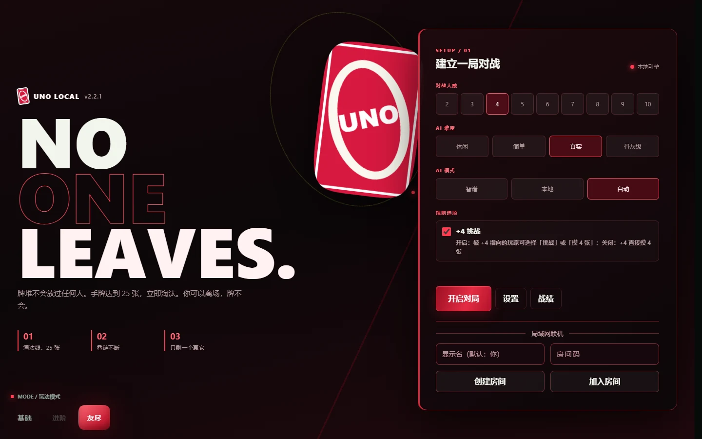
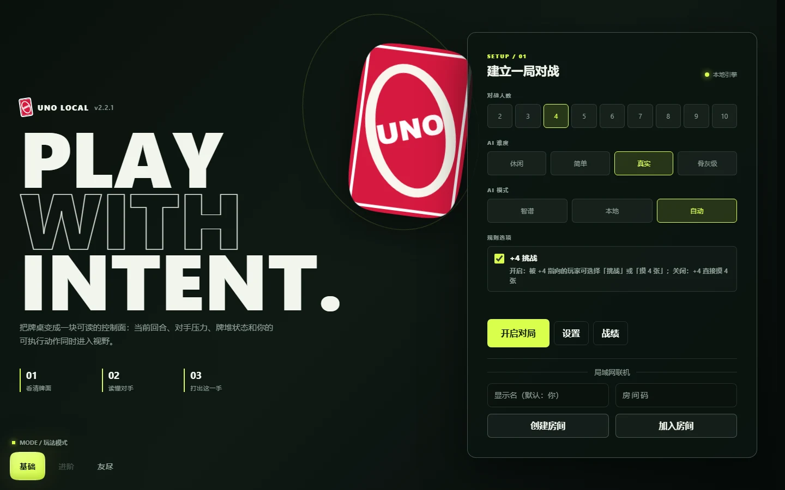
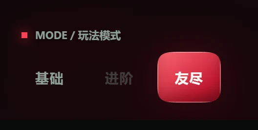
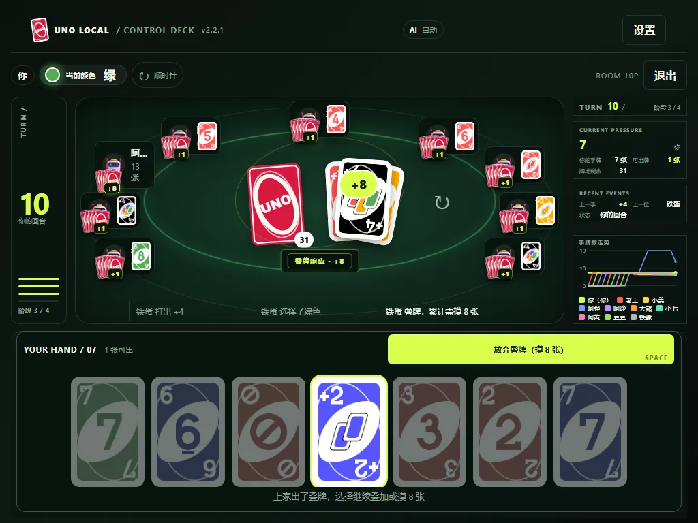
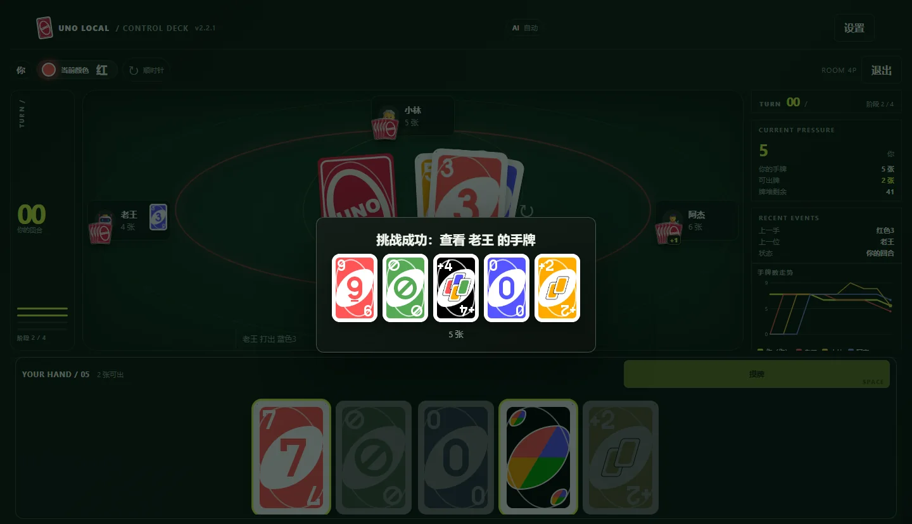
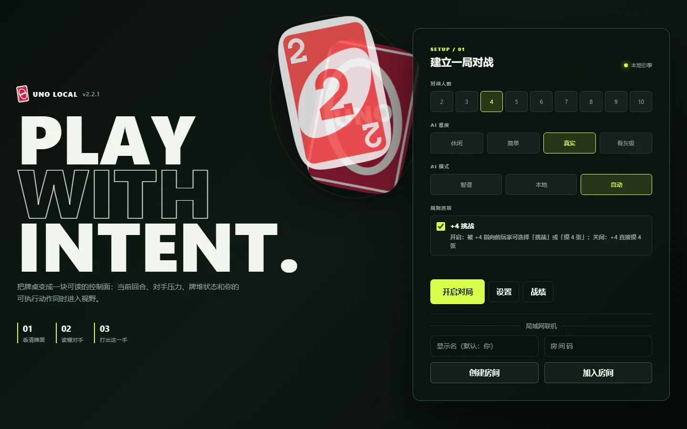
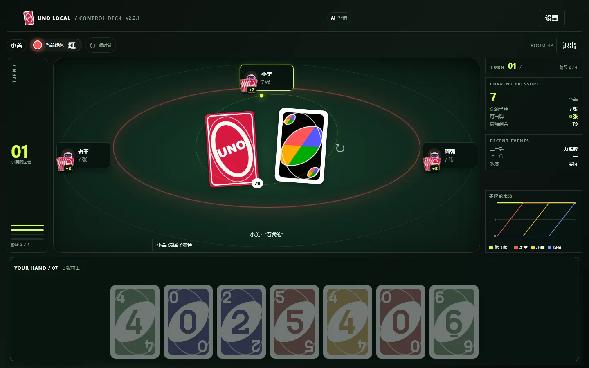
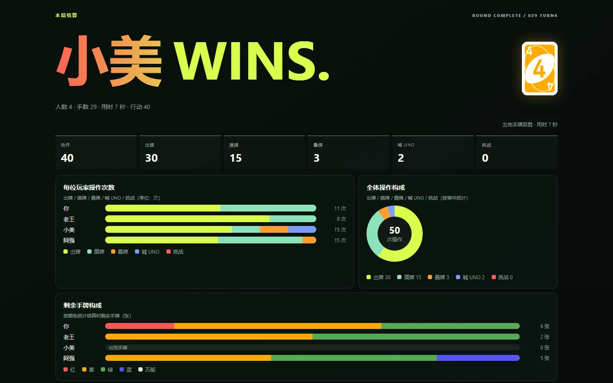

# UNO LOCAL · 换一档牌桌，换一整套脾气

> 想打一局 UNO，不用凑人、不用联网，也不用记分。
> 大厅左下角换一档：**基础 108 张**，或者 **友尽 168 张、手牌到 25 张直接淘汰**。
> **PLAY WITH INTENT. / NO ONE LEAVES.** —— 先看清局势，或者先活下去。

[](https://github.com/shark-syh/uno-personal-game/actions/workflows/ci.yml)


[](https://github.com/shark-syh/uno-personal-game/releases/latest)

<p align="center">
  
</p>

<p align="center"><em>友尽模式大厅：整块界面换成血红主题，巨字、说明、三条索引、按钮与左下角切换器一起变。装饰牌统一显示仓库自带的卡背，权限申明见文末。</em></p>

往下翻：这游戏想做什么 → **换一档会发生什么** → 友尽 / 基础两套规矩 → 三屏怎么走完一局 → 它怎么跑起来 → 怎么装来玩。

## 这游戏到底想做什么

它不是「把 UNO 搬到电脑上」就完事了。更想解决的，是突然想打一局、却凑不到人的那种空落落的感觉——所以这里没有账号、没有匹配、没有每日任务，打开就能坐下一桌，打完就走。

另一半心思花在「看得清」上。我们叫它 **Orbit Control**：中间一张椭圆牌桌，左边一条回合轨，右边一块常驻数据栏。第几回合、谁还剩几张、牌堆快见底没、刚才谁干了什么、所有人的手牌怎么一点点变少，全都同时摆在眼前，不用翻页、不用猜。

原来的荧光绿牌桌讲「**PLAY WITH INTENT.**（带着想法出牌）」。这次加进来的友尽版讲另一句话：「**NO ONE LEAVES.**（谁也别想走）」——同一套三屏界面，换成 168 张牌、25 张淘汰线和血红主题，气质就完全反过来了。

有三件我们挺坚持的小事：

- **不凑人**：2~10 个座位，除了你都可以是 AI。断网、没 Key、没额度，一样能把一局打完。
- **不记分**：赢了就是赢了。结算页没有「本局得分」，只有这一局发生过什么。
- **不蒙牌**：信息摊在一屏里，出哪张是你自己判断的，不是靠蒙。

**一局的路径**：`01 大厅`（选人数 / 难度 / 玩法模式）→ `02 牌桌`（一屏三栏 · 出牌 / 摸牌 / 叠牌）→ `03 结算`（谁赢了 + 这一局发生了什么）↩ 点「再来一局」回到大厅。三屏的细节往下翻。

## 换一档，换一整套牌桌

大厅左下角那块 **MODE / 玩法模式** 切换器是两套玩法的入口：三档「基础 / 进阶 / 友尽」，进阶（Flip）方案暂缓、灰显不可选。切到友尽，界面和规则一起换，不用刷新、不用重开页面。

<table align="center">
  <tr>
    <td></td>
    <td></td>
  </tr>
  <tr>
    <td align="center"><strong>基础</strong> · 近黑底 + 荧光绿 <code>#d9ff4b</code></td>
    <td align="center"><strong>友尽</strong> · 暗红底 + 血红 <code>#ff4054</code></td>
  </tr>
</table>

| | 基础 classic | 友尽 mercy |
| --- | --- | --- |
| 牌堆 | **108 张** | **168 张**（68 个唯一面） |
| 牌型 | 6 种 | 13 种（新增 7 种，且不含普通 wild / wild4） |
| 叠牌 | 宽松叠牌：+2 / +4 任意互叠 | **官方叠链**：只能出等值或更高的罚牌，+10 封顶 |
| +4 挑战 | 大厅可开关 | 不适用（官方 No Mercy 取消质疑） |
| 淘汰 | 没有 | 手牌 **≥25 张立即出局**，手牌搁置、重洗时放回 |
| 怎么赢 | 先出完手牌 | 先出完手牌，或成为**最后幸存者** |
| 界面 | 荧光绿 Orbit Control | 同一套三屏，整屏换成暗红主题 |
| 卡面 | 仓库自带 54 张 CC0 | 本机自备 68 张 B 版素材，缺素材降级为文字牌面 |

<p align="center">
  
</p>

<p align="center"><em>切换器特写：荧光小方块、字距标签、连续曲率 squircle 滑动指示器；选中友尽时指示器换成红色渐变，进阶档保持灰显。</em></p>

几个刻意定下来的细节：

- **只在大厅显示**。进了对局 / 结算屏自动隐藏，不会压在手牌区上；对局中改档只影响**下一局**，不动正在打的那局。
- **只在当前页面会话有效**。刷新回基础模式，不写 `localStorage`——mode 是开局参数，不是设置项；单机开局 / 再来一局 / 联机 `start-game` 三处都会把 mode 透传下去。
- **主题按需加载**。默认大厅根本不加载友尽样式表，第一次点到 / 悬停友尽档才动态插入 `mercy-mode.css`；切换时走 90 ms 淡入淡出，`prefers-reduced-motion` 下直接切，不做动画。
- **文案跟着换**。巨字 `PLAY WITH INTENT.` → `NO ONE LEAVES.`，说明行换成「牌堆不会放过任何人。手牌达到 25 张，立即淘汰。你可以离场，牌不会。」，三条索引变成「淘汰线：25 张 / 叠链不断 / 只剩一个赢家」。大厅、牌桌、结算三屏共用同一套配色。
- **一切圆角仍是连续曲率 squircle**，右栏两块数据卡按老规矩保持直角。

## 友尽模式：牌堆不会放过任何人

这套规则来自 UNO Show 'Em No Mercy，按 `docs/三模式升级-友尽模式规则契约.md` 落地。核心就一句：**手牌越多越危险，到 25 张直接出局**——被淘汰者的手牌先搁置，牌堆耗尽重洗时再放回，回合自动越过他；全场只剩一人时，他以 `last-survivor` 获胜。

**牌堆构成**（168 张）：

| 类别 | 组成 | 张数 |
| --- | --- | --- |
| 数字牌 | 0~9 各色 2 张 × 4 色 | 80 |
| 彩色功能牌 | Skip / Reverse / Draw 2 / Discard All 各色 3 张 × 4 色 | 48 |
| 彩色功能牌 | Draw 4 / Skip Everyone 各色 2 张 × 4 色 | 16 |
| 万能牌 | 反转 +4 ×8、颜色轮盘 ×8、+6 ×4、+10 ×4 | 24 |

**新增的 7 种牌型**：彩色 `Draw 4`、`Skip Everyone`、`Discard All`，以及四张随时可出、不受「手里没有当前颜色牌」限制也不可质疑的万能牌 `Wild Draw 6` / `Wild Draw 10` / `Wild Reverse Draw 4` / `Wild Color Roulette`。

**数字牌里藏了两把刀**：打出 **7** 必须与任意一位仍在局中的玩家交换整手牌（强制，弹窗选目标）；打出 **0** 则全体按当前方向把手牌传给下一位（只旋转活跃座位）。

其余效果逐张看：

| 牌 | 效果 |
| --- | --- |
| Skip Everyone | 其余玩家全部跳过，自己立即再来一回合，方向不变 |
| Discard All | 弃掉手里所有同色牌压在该牌下方，顶牌与颜色不变，可一次清空直接获胜 |
| Wild Draw 6 / 10 | 出牌者选色，下家抽 6 / 10 并跳过；+10 是叠链上限 |
| Wild Reverse Draw 4 | 先反转方向 → 新方向下家抽 4 → 出牌者选色；2 人局变成自己抽 4，可立刻叠罚牌回敬 |
| Wild Color Roulette | **下家**选色 → 逐张翻抽直到抽到该色（Wild 不计）→ 全部进手牌并被跳过；双堆耗尽时兜底停止并跳过 |

**叠链**按官方口径：被 +2 / +4 / +6 / +10 / 反转 +4 指到时，只能打出**等值或更高**的罚牌把累计额推给下家，Skip / Reverse 不能叠；第一个接不住的人一次性抽走累计总额并被跳过。右栏会实时显示累计需摸张数。换手和轮盘各有一个专属弹窗，不会挤在 44px 的细轨里；被淘汰的座位灰显去饱和。

界面上，友尽对局屏从牌桌径向渐变、对手卡描边、右栏数据卡 / 折线图 / 阶段标签到手牌坞，全部换成暗红系；叠链累计、淘汰状态、换手 / 轮盘待选座位跟着引擎的 `mercy` 摘要走。联机同样支持：房主在大厅选好 mode，`start-game` 带过去，服务端按座位脱敏后再广播。

> **关于卡面**：友尽 B 版 68 张 webp 只用于作者本人本机学习演示，**不进仓库、不进 exe、不进 Release**（`.gitignore` 与 `electron-builder.yml` 双重排除）。本机把素材放到 `apps/web/cards-mercy/` 就会自动启用；缺素材时 `renderCard()` 降级成色块 + 文字牌面，规则照常跑。完整权限申明见文末与 `research/open-mercy/README-来源与裁剪.md` §6.5。

## 基础模式：让牌局上头的三条规矩

**宽松叠牌：数字会滚雪球。** +2 压 +2、+4 压 +2，反过来也行，颜色先放一边。链子越接越长，累计摸牌数一直涨，直到有人认怂，把那一摞一次性摸走。胜负常常在这一瞬间翻过来。

<p align="center">
  
</p>

<p align="center"><em>10 人桌也不糊：桌上写着「累计需摸 8 张」，右栏折线照常跑，每个座位都还在自己的位置上。</em></p>

**摸到能打为止。** 主动摸牌不是摸一张就停——会一直摸到摸出一张能打的牌，中途摸到的都留在手里；这一张要么打出去，要么结束回合。官方是摸 1 张，这里让牌局变长了一点，也多了一点「下一张会不会就是它」的期待。

**+4 挑战：可以赌一把。** 被 +4 指到的人，可以选择老实摸 4 张，也可以挑战、要求看对方手牌。人挑战 AI 时，对方的手牌会完整亮 2.6 秒；AI 挑战人时不泄露牌面，只留一句「XX 查看了你的手牌」。

<p align="center">
  
</p>

<p align="center"><em>「挑战成功：查看老王的手牌」——他到底有没有赖，变成一个看得见、也可以赌的瞬间。</em></p>

其余和原版不太一样的地方，一张表看完：

| 项目 | 基础模式怎么玩 | 说明 |
| --- | --- | --- |
| 叠牌 | 宽松叠牌 | +2 / +4 任意互叠、累计摸牌；链中的 +4 不开放挑战（友尽改官方叠链） |
| 主动摸牌 | 摸到能打为止 | 官方是摸 1 张 |
| +4 挑战 | 开启 | 大厅可关，关掉后 +4 直接摸 4 张 |
| 2 人特殊规则 | 开启 | Reverse 变 Skip、动作牌连动；可关 |
| UNO 罚牌 | 2 张 | 设置里可选 1 / 2 / 3 张 |
| 牌堆耗尽 | 洗回弃牌堆 | 可切「耗尽即结束，手牌最少者胜」，并列为平局 |
| 起手动作牌 | 照常生效 | 可切「忽略动作牌，继续翻牌」（友尽起手只认数字牌） |
| 计分 | 没有 | 结算只给操作统计图表，本地战绩也只记对局数和胜场 |

完整规则规格在 [`docs/开发计划.md`](docs/开发计划.md) 第 2 章，友尽规则契约在 [`docs/三模式升级-友尽模式规则契约.md`](docs/三模式升级-友尽模式规则契约.md)。

## 三屏，走完一局

> 下面这几张截图是**基础模式**界面；友尽模式的三屏结构完全相同，只是配色换成暗红、多出叠链累计与淘汰灰显。

### 01 大厅：一屏开一局

<p align="center">
  
</p>

<p align="center"><em>左边是巨字标语和一张随机大牌，右边一张 SETUP 卡把开局要选的东西全收进去了。</em></p>

人数（2~10）、AI 难度、AI 模式、要不要开 +4 挑战、局域网开房或输房间码加入，都在右边这一张卡里；玩法模式在左下角切换器。点「开启对局」，牌就从牌堆飞到每个座位上。

### 02 牌桌：信息都摆在明面上

对局屏是三栏加一条手牌坞：

| 位置 | 你能看到什么 |
| --- | --- |
| 左边回合轨 | 第几回合、轮到谁、现在走到哪一步 |
| 中间椭圆牌桌 | 牌堆、弃牌堆、当前颜色与方向、沿轨道坐好的 1~9 个对手 |
| 右边数据栏 | TURN 回合数、CURRENT PRESSURE（你的手牌 / 可出牌 / 牌堆剩余）、RECENT EVENTS（上一位做了什么）、叠链累计（友尽），下面压着所有人手牌数的走势折线 |
| 下面手牌坞 | 你的手牌，和内嵌在细轨里的动作条；能出的牌会自己亮起来 |

<p align="center">
  
</p>

<p align="center"><em>轮到谁、还剩几张、刚才出了什么、大家手牌怎么变，一眼看完；牌友偶尔还会在桌中间留一句话。</em></p>

一条荧光绿长条（友尽是红色渐变）是当下最主要的操作，按 <kbd>Space</kbd> 和点它完全等价——只是多一种手感，在输入框或弹窗里不会误触。折线图是纯 SVG 画的，谁在偷偷减牌、谁被摸牌链拖住，看线就知道。友尽的换手 / 轮盘两阶段会各弹一个独立弹窗，不占用动作条。

### 03 结算：不讲分数，讲这一局发生了什么

<p align="center">
  
</p>

<p align="center"><em>巨字「XX WINS.」、六格操作统计、两张动作图表、剩余手牌构成——从头到尾没有一个分数。</em></p>

有人出完最后一张、牌堆见底，或者友尽里只剩最后一位幸存者，屏幕就切到这里。顶部是巨字胜者，右上角留着他最后打出的那张牌；中间六格数着这一局的动作、出牌、摸牌、叠牌、喊 UNO、挑战；再往下是每位玩家的动作次数、全体动作构成和剩余手牌的颜色。图表用纯 CSS / SVG 画，数字来自引擎记下的整局事件，不是界面自己现算的。

## 一局牌是怎么走的

1. 在大厅挑好人数、难度、AI 模式，顺手在左下角选基础 / 友尽。
2. 点「开启对局」，发牌动画把牌送到每个座位，翻出一张起始牌。
3. 轮到你，能出的牌自动亮起，点一下就出；没得出了就点「摸牌」，或者按 <kbd>Space</kbd>。
4. 主动摸牌会一直摸到摸出一张能打的牌，中途摸到的都进手牌；这一张要么打出去，要么结束回合。
5. AI 会短暂想一下再出牌。接了智谱的话，它们偶尔冒一句台词，停 2.6 秒就散。
6. 友尽里还要盯着手牌数：一旦到 25 张就出局；换手 / 轮盘轮到你时，弹窗里选目标座位或颜色。
7. 有人打完手牌、牌堆见底，或只剩一位幸存者，这局就停。没有下一关，想再来一局点一下就行。

## 牌友不是木头人

AI 分四档：休闲、简单、真实、骨灰级。档位不只是「多想一会儿」，它真的会改记牌、留牌、叠不叠、挑不挑战、抓不抓 UNO 的选择。同一手牌交给不同档位，下一步常常完全不一样。友尽里补了换手目标（按对方手牌数启发）与轮盘选色两类新动作的候选。

本地 AI 完全离线：先把能做的动作列成候选，逐张打分，记住已经出现过的牌，再从合法动作里挑一个，通常只要几毫秒。接了智谱之后多一步：把公开信息和自己的手牌整理成候选交给模型选，回来还得过一遍本地合法性校验。模型选错、超时、额度用完，都自动退回本地 AI，牌局不会卡在那儿等它。

| 轮到 AI 时 | 决策路径 | 出问题时 |
| --- | --- | --- |
| 本地 / 自动且无 Key | 本地启发式：列出候选 → 逐张打分 → 记牌 → 挑一个 | — |
| 智谱 | 服务端代理整理候选 → 模型选牌 → 本地合法性校验（合法 / 没超时 / 没限流） | 选错 / 超时 / 额度用完，自动退回本地 AI |

两条路最后都汇到**同一个出牌入口**，走同一条规则链，牌局不会卡在等待模型上。

在线决策会慢一些（思考型模型一次约 3~4 秒），所以下一步的请求会在上一步动画播放时就提前发出；动画放完，回答往往已经在路上。状态栏悬停能看到最近一次用的模型和耗时。想秒回，把 AI 模式切到「本地」就好。Key 只在服务端读，不会进前端代码；桌面版还可以在设置页自填，用 DPAPI 加密存起来。

## 背后是怎么跑起来的

一句话：**引擎是唯一的裁判，界面只负责把裁判说的话演出来。**

```text
[你的操作] 点一张手牌
   → UiAction
   → game-core: applyAction(state, action)
   → 新 state + events
        ├→ public-view（按座位脱敏）→ window.UnoApp.render（牌桌 / 右栏 / 手牌）
        └→ 事件队列（动效 + 音效）→ 上面同一个 render
[AI 的一步] AI 选好一步 → 同一个 UiAction 入口
```

拆开说，就是这么几件事：

1. **一个纯函数管全部规则。** `applyAction(state, action)` 吃进旧状态和一步动作，吐出新状态和一串事件（`packages/game-core`）。同一个 seed 加同一串动作，一定能复现同一局——所以 AI 自对弈能一口气跑 700 局专门找非法动作，友尽另跑 200 局查 168 张守恒。
2. **mode 是一条独立的轴。** `normalizeGameConfig({ mode: 'mercy' })` 把叠链锁成 `official`、关掉 `challengeWild4`；`GameView` 顶层带 `mode` 与 `mercy` 摘要（待换手 / 轮盘座位、搁置牌数、淘汰座位）、`players[].eliminated`、`table.stackTotal`。**classic 的 `playCard` 路径逐字未动**。
3. **每人只看到该看的。** `public-view.ts` 在状态出门前先脱敏：别人的手牌、牌面、+4 判定依据、挑战时才亮出的手牌，都按座位过滤掉。友尽新增的 8 类事件按定义字段显式重建，换手 / 传手后 `drawnThisTurn` 与基于它的 `PLAY_DRAWN` 动作都按座位剔除，杜绝牌面串座。联机时这一步由服务端做。
4. **界面是被事件推着走的。** 发牌、出牌、摸牌、跳过、反转、叠牌、挑战、UNO、洗牌、换手、传手、轮盘、淘汰……事件进同一个队列，一个播完再播下一个，播放时锁住输入。动效只改 `transform` 和 `opacity`，10 人桌也不会满天飞牌；队列结束，临时元素和定时器都清干净。
5. **声音是现算的。** 16 类事件音全部由 WebAudio 的振荡器和噪声合成，仓库里没有一个音频文件。浏览器不让自动播放，所以第一次点击 / 按键之后才解锁，也能单独关掉或调三档音量。
6. **联机时服务端说了算。** 房间状态在服务端内存里，客户端只发意图、收自己那份视图；掉线自动重连坐回原位，实在回不来由服务端 AI 顶着，房主走了自动移交给下一位。协议白名单补了 `SWAP_HANDS` / `CHOOSE_ROULETTE_COLOR`，`flip` 明确拒绝、不静默回退。

代码大致分成这几块：

```text
apps/web/              界面 · 原生 HTML/CSS/JS，零构建
  ├─ js/engine/        对局调度、AI 决策、UNO 窗口、台词、事件队列
  ├─ js/ui/            大厅 / 牌桌 / 手牌 / 结算渲染、模式切换器
  ├─ js/animation/     事件动效与串行队列
  ├─ js/audio/         WebAudio 合成音效
  ├─ styles/           tokens / layout / mode-switch / mercy-mode（按需加载）
  └─ js/vendor/        uno-engine.js（TS 引擎 + 本地 AI 的浏览器打包产物）
apps/server/           Express：静态托管 + 智谱代理 + /ws 联机房间
apps/desktop/          Electron：内嵌服务、UDP 房间发现、Key 安全存储、NSIS 安装包
packages/game-core/    纯函数规则引擎 + 公开视图 + 结算统计
packages/ai/           候选生成 / 特征评分 / 记牌 / 四档难度 / 自对弈
scripts/               自对弈、浏览器验收、性能检查、打包与卡面处理
docs/                  开发文档与本文截图
```

没有数据库、没有账号、没有遥测。设置和那点对局数 / 胜场，就放在浏览器 `localStorage` 里；模式偏好只活在内存里。

## 和朋友坐一桌

同一局域网里，一台电脑开服务（双击 `启动服务.bat`，或 `npm start`），其他设备打开它打印的局域网地址，输 6 位房间码就坐到同一张桌上。桌面版还会自动发现「附近房间」，点一下就能进；UDP 广播被防火墙挡了，也可以手填 `IP:端口`。

进房能改名，房主可以给空位补 0~9 个 AI——一个人也能先开一局。房主在大厅选的 mode 会随 `start-game` 带进房间，`rematch` 沿用；对局由服务端统一裁决，别人摸了几张能数、但看不到牌面；刷新页面会静默恢复，房主断线自动移交，一局结束点「再来一局」原班人马直接重开。等待和对局中还能发 12 个预置表情，气泡落在自己座位框下面，每座位连发 5 条后冷却 2 秒。

> 联机的 AI 固定用本地启发式（智谱在线决策还没接进联机）；房间只存在服务器进程内存里，服务重启就得重新开房；UDP 发现只管同一网段，不支持公网。

## 装起来、跑起来

> **版本口径先说清楚**：代码、界面角落与 `package.json` 已统一到 **`v2.3.0`**（仓库 tag `v2.3.0` + M 系列模块 tag `m5`），包含三模式升级 M1~M5、友尽 UI 终版与 README 双模式改写。**v2.3.0 的 Windows 安装包是作者本人本机自用的完整包**（含 68 张友尽卡面、全部功能可用），按权限申明 **不外传、不上传 Release**；所以 GitHub Release 里能下载的公开安装包仍是 **`v2.2.0`**（不含友尽模式）。公开渠道想玩完整双模式，请用源码运行。

| 想做什么 | 拿哪个 |
| --- | --- |
| Windows 双击就玩（公开包，基础模式） | [`UNO-Setup-2.2.0.exe`](https://github.com/shark-syh/uno-personal-game/releases/download/v2.2.0/UNO-Setup-2.2.0.exe)（约 107 MiB，装当前用户，不用管理员；Release 最新公开包，不含友尽模式） |
| 完整双模式（本机自用） | `UNO-Setup-2.3.0.exe`（本机重打，含 68 张友尽卡面与全部功能；按权限申明不外传，公开渠道不提供下载） |
| 看代码 / 玩双模式 | [`v2.3.0` 源码 zip](https://github.com/shark-syh/uno-personal-game/archive/refs/tags/v2.3.0.zip) 或 `git clone` |
| 只想在浏览器里开一局 | 下面三条命令 |

公开 `UNO-Setup-2.2.0.exe` 的 SHA256 是 `A38857EBD3501898DD062C9C917F982C770208CE03B3AB4B2BD34F6847E9FE7B`，与 Release 附的 `SHA256SUMS.txt` 一致；本机自用 `UNO-Setup-2.3.0.exe`（114,975,020 B）是 `FC0DBBF6EE23CB983D0C5E36ADFAB73E1F56ECB7581C81FBF1B4B7C090A99BFE`。安装包没做代码签名，SmartScreen 可能提示「更多信息 → 仍要运行」；首次开房时 Windows 会问防火墙权限，允许后同网段的朋友才能发现房间。

```bash
git clone https://github.com/shark-syh/uno-personal-game.git uno
cd uno
npm install
npm run dev
# 浏览器打开 http://localhost:3000
```

Windows 也可以直接双击 **`启动服务.bat`**（首次先 `npm install`），服务起来后会自动开浏览器。需要 Node.js ≥ 22、Chrome / Edge；联网只在首次装依赖和启用智谱 AI 时才需要，本地 AI 完全离线。启动动画现在每次打开页面都会播一遍，点一下或按任意键可跳过，`?boot=0` 直接跳过。

想要独立窗口就跑桌面版：`npm run desktop:dev` 开发启动，`npm run desktop:dist` 打出 NSIS 安装包。桌面版自带内嵌服务，不依赖外部浏览器和 Node.js，设置页里还能自填智谱 Key。**仓库默认的打包配置按权限申明排除友尽 B 版卡面**（缺素材自动降级为文字牌面）；v2.3.0 的本机自用完整包在打包时临时放开该过滤以带上 68 张卡面，仅作者本人本机使用、不外传。

智谱是可选的，不配也能玩：

| 变量（`.env`） | 说明 | 默认 |
| --- | --- | --- |
| `ZHIPU_API_KEY` | [智谱开放平台](https://bigmodel.cn/usercenter/proj-mgmt/apikeys) 的 Key | 空（只用本地 AI） |
| `ZHIPU_MODEL` | 首选模型 | `glm-4.7-flash`（免费） |
| `ZHIPU_FALLBACK_MODELS` | 失败 / 下线时自动切换 | `glm-4.5-flash,glm-4-flash` |
| `AI_DECISION_TIMEOUT_MS` | 单次决策超时，超时降级本地 | `6000` |

设置项（音效、动画速度、AI 速度、自动喊 UNO、2 人规则、UNO 罚牌张数、牌堆耗尽策略等）存在 `localStorage` 的 `uno:settings` 里；规则项只对**之后新开**的对局生效。改了 `packages/game-core` 或 `packages/ai` 记得跑 `npm run build:web-engine`，改了静态资源 `Ctrl+F5` 强刷。

## 常用命令

| 命令 | 作用 |
| --- | --- |
| `npm run dev` / `npm start` | 启动本地服务 → <http://localhost:3000> |
| `npm test` | 单元测试（37 文件 / 392 用例） |
| `npm run typecheck` / `npm run lint` | TypeScript 与 ESLint 检查 |
| `npm run build:web-engine` | 把 TS 引擎 + AI 打包成浏览器 ESM |
| `npm run verify:ui` | 单机浏览器自动验收（208 项，无头 Chrome + CDP，需服务已启动） |
| `npm run verify:online` | 联机双客户端验收（44 项） |
| `npm run perf` | 首屏 / 帧率 / 内存 / AI 耗时检查 |
| `npm run selfplay` | classic AI 自对弈基准（700 局，非法动作 / 异常 / 难度排名） |
| `npm run selfplay -- --mode mercy` | 友尽 4 人混战（200 局，168 张守恒 / 每局决出胜者） |
| `npm run demo:turn -- --players 4 --seed m17-demo` | 命令行整局回放 |
| `npm run desktop:dev` / `desktop:dist` | 启动桌面版 / 打 NSIS 安装包 |

> 本机环境两个已知坑：esbuild 临时目录写入权限可把 `TEMP` / `TMP` 指到项目内 `logs/` 绕开；2026-11-14 曾在定制 node 下遇到 vitest 默认 `forks` / `threads` 池 collection 阶段全挂（已确认非项目回归，本次默认池直接 392/392 全绿），真遇到时用 `npm test -- --pool=vmThreads` 复核即可。

## 现在跑到哪儿了

三模式升级 **M1~M5 全部收口**，经典模式路径与既有断言零改动：

| 阶段 | 做了什么 |
| --- | --- |
| M1 | `GameConfig.mode` 三模式框架、13 种牌型、classic 108 / mercy 168 牌堆 |
| M2 | 友尽引擎效果：7 换手 / 0 传手 / 全员跳过 / 全弃 / 颜色轮盘 / +6 / +10 / 反转 +4、25 张淘汰与最后幸存者 |
| M3 | 视图 `mode` + `mercy` 摘要、8 类事件按座位脱敏、联机 mode 透传与 AI 候选 |
| M4 | 68 张 B 版卡面按 mode 切资源、左下角三档切换器、换手 / 轮盘弹窗、淘汰灰显、叠链累计 |
| M5 | 正式友尽断言（`--mode mercy`、`sameAction` 严格比对、守恒 108/168）与全量回归 |

最近一次全量自检（M5 + 友尽 UI 终版 + 1024 布局修复）：

| 检查 | 结果 |
| --- | --- |
| `npm run lint` / `typecheck` | 0 错误 |
| `npm test` | **392 / 392**（37 文件，新增 `mercy-selfplay.test.ts` 6 条） |
| `npm run verify:ui` | **208 / 208**（三屏结构、三局真实对局、2/4/6/10 人布局、九档视口、挑战揭示、UNO 窗口、动效降级） |
| `npm run verify:online` | **44 / 44**（建房 / 加入、座位视角、表情限频、UNO 分流、房主移交） |
| `npm run selfplay` | classic **700 局**非法 0 / 异常 0；mercy **200 局**非法 0 / 异常 0 / 守恒 168 全过 / 每局有胜者（淘汰 192 局、最后幸存者 161 局）。classic 的「相邻难度胜率单调」仍是遗留已知项 ❌（4 人混战平均名次已单调） |
| `npm run perf` | FCP **144 ms** / FPS **60** / 堆 2 MB |

逐条变更见 [`CHANGELOG.md`](CHANGELOG.md)，活跃台账与红线见 [`docs/开发进度.md`](docs/开发进度.md) §4。

## 还有哪些小毛病

- **进阶（Flip）模式方案已写但暂缓**，第三档灰显禁用；B 版里也没有任何 Flip 卡面，真要做需要第三套素材。
- **公开 Release 仍停留在 v2.2.0**：v2.3.0 完整安装包是本机自用、按权限申明不外传，所以公开渠道暂时下载不到带友尽模式的新 exe；代码与界面版本号本身已统一到 2.3.0。
- 友尽的 B 版卡面不随仓库 / 公开渠道分发，公开配置打出的产物会显示文字牌面；本机自用完整包内含 68 张，仅本人非商业使用。
- 模式偏好只在当前页面会话有效，刷新回基础模式；对局中切换下一局才生效。
- 单机刷新会中断对局（还没做快照恢复）；联机房间在内存里，服务重启就没了。
- 联机 AI 固定本地启发式；UDP 发现只管同一网段，不支持公网。
- 移动端只是基础响应式，桌面才是主要场景；`verify:desktop` 在本机沙箱里会 SKIP，需真机验收。
- 智谱在线决策一次约 3~4 秒；规则设置只对新开的对局生效。
- 自对弈里「相邻难度胜率单调」是 classic 的遗留已知项（混战平均名次已单调；友尽胜负含规则性运气，不做该判定）。
- `verify:ui` 的矮屏折线图与 AI 台词 TTL 两处断言对时序敏感，连续复跑会偶发失败，单独复跑即回到 208/208。
- 安装包未做代码签名，桌面版的安装 / 卸载、双机 UDP 发现、DPAPI 还没在真实用户环境走一遍；CI 曾在本机 esbuild 权限下失败，需读日志定位。
- 没附开源许可证（个人学习项目），第三方素材来源见 [`research/README.md`](research/README.md)。

## 文档与常见问题

想接着看代码或改点什么：[`docs/开发总档.md`](docs/开发总档.md)（一份读完整个项目）· [`docs/开发进度.md`](docs/开发进度.md)（活跃台账与红线）· [`docs/三模式升级-友尽模式规则契约.md`](docs/三模式升级-友尽模式规则契约.md)（友尽规则）· [`docs/三模式升级-Flip模式开发方案.md`](docs/三模式升级-Flip模式开发方案.md)（暂缓的进阶方案）· [`docs/开发计划.md`](docs/开发计划.md)（基础规则规格与架构）· [`docs/E2E测试指南.md`](docs/E2E测试指南.md)（验收脚本怎么用）· [`docs/README.md`](docs/README.md)（文档索引）。

| 现象 | 怎么办 |
| --- | --- |
| 打开 `localhost:3000` 没页面 | 服务没起：`npm run dev` 或双击 `启动服务.bat`，看到 `[uno-server] 已启动` 再刷新 |
| 提示 `EADDRINUSE` | 3000 被占了：改 `.env` 的 `PORT`，或关掉占用端口的程序 |
| AI 不动 / 页面像旧版 | `Ctrl+F5` 强刷；确认 `apps/web/js/vendor/uno-engine.js` 在，或重跑 `npm run dev` |
| 刷新后又变回基础模式 | 故意的：mode 只在当前页面会话有效，重新在大厅左下角选一次即可 |
| 对局里找不到模式切换器 | 它只在大厅显示；对局中改档对下一局生效，不会打断当前这局 |
| 友尽卡面变成文字色块 | 权限申明要求 B 版素材不随仓库 / 安装包分发；本机把 68 张 webp 放进 `apps/web/cards-mercy/` 即自动启用，规则不受影响 |
| 智谱报错 / 显示「本地·降级」 | 查 Key、网络和额度；失败会自动回本地 AI，不影响打牌 |
| 想只看界面演示 | 打开 `http://localhost:3000/?mock=1`，工具条能切演示局面 |
| 不想看启动动画 | `?boot=0` 直接跳过，或点击 / 按键立即跳过 |
| 改了配置没生效 | `.env` 改动要重启服务；设置项只对新开的对局生效 |

## 关于这个项目

- 这是**个人非商业学习项目**，与 Mattel / UNO 官方没有任何关联；UNO® 与 UNO Show 'Em No Mercy® 均为 Mattel, Inc. 的注册商标。
- 基础模式卡面来自 CC0 资源（见 [`research/README.md`](research/README.md)），只用于个人学习演示。
- **友尽 B 版卡面**仅用于作者本人个人学习、研究与非商业演示，卡面美术、图形、符号与 trade dress 权利归 Mattel 或原权利人；上游 MIT 许可证只覆盖软件与文档，不构成对美术 / 商标的授权。按 `research/open-mercy/README-来源与裁剪.md` §6.5 与契约 §8，该素材**不随安装包、GitHub Release 或任何公开分发渠道外传**，本项目不主张原创权利、不标注为开源卡面。
- 请勿用于商业用途或对外提供 UNO 游戏服务；公开传播或商用请自行评估商标与版权风险。
