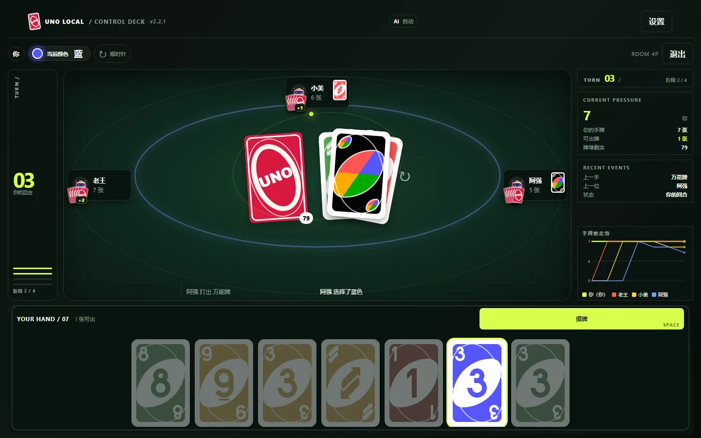
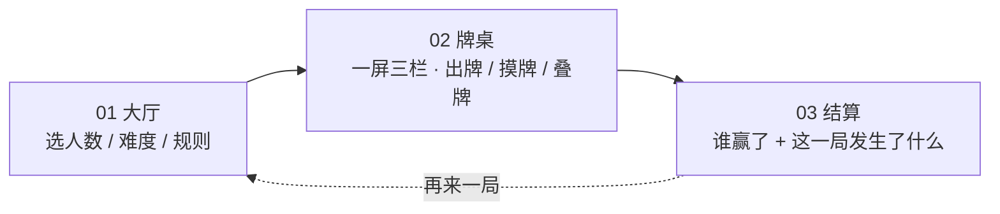
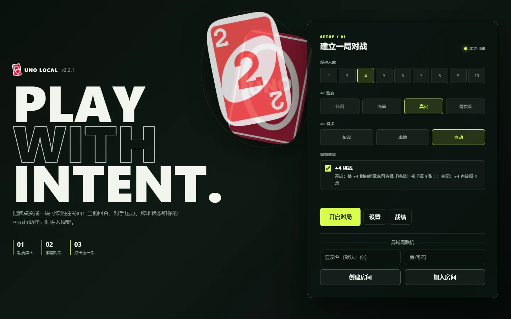
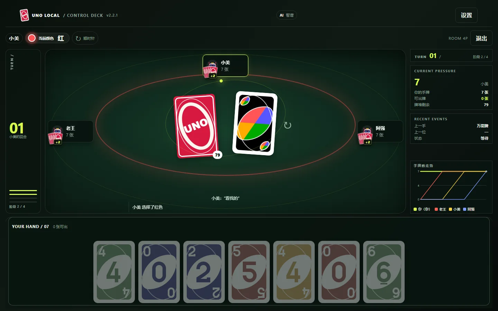
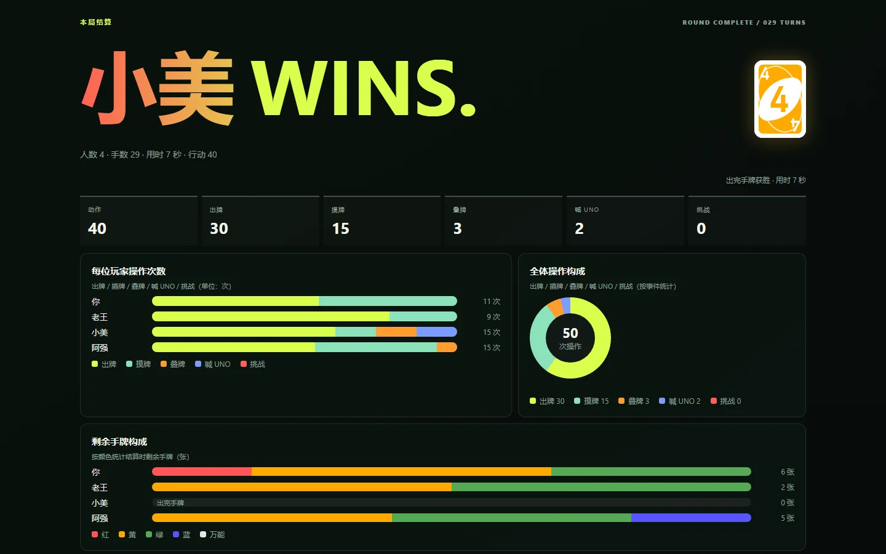
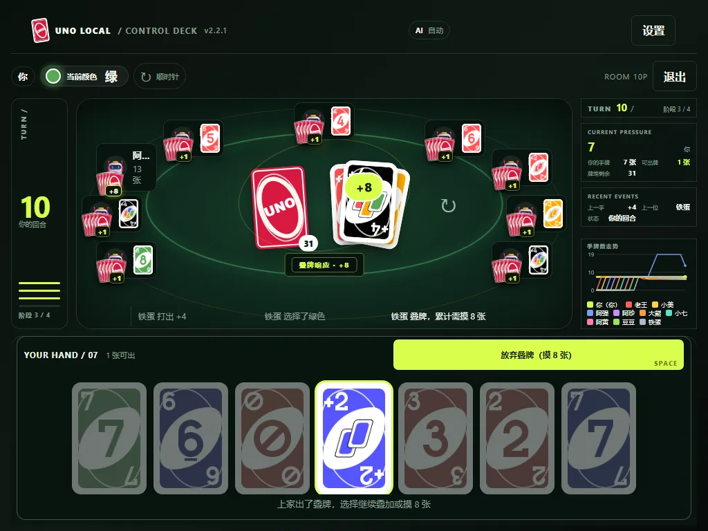
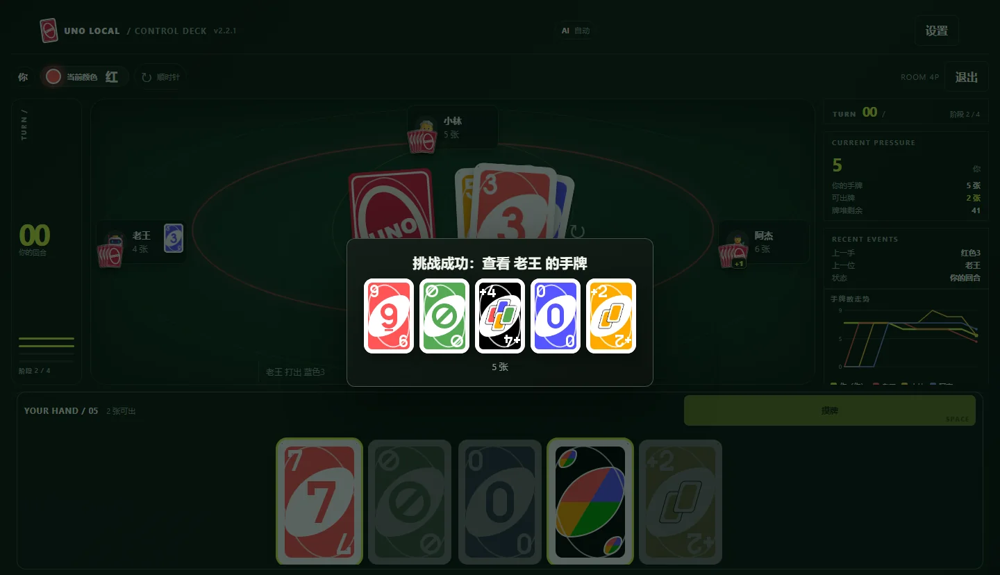
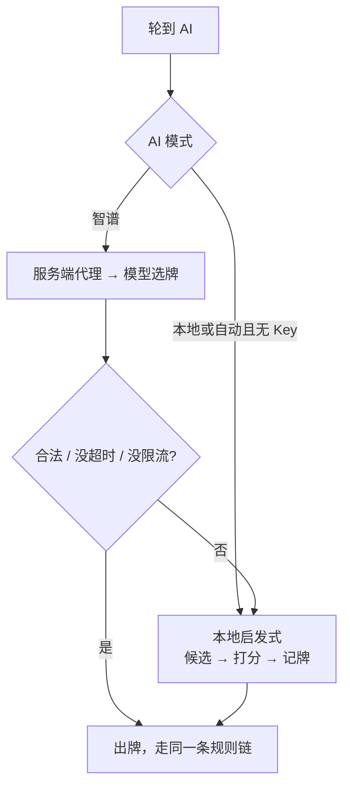
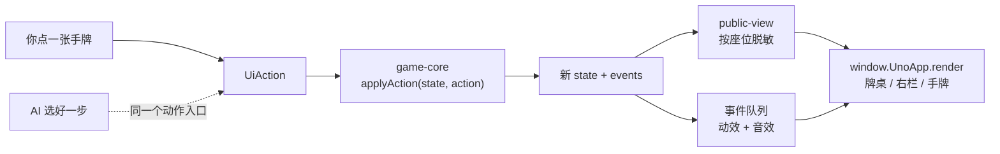

# UNO LOCAL · 把牌桌变成一块控制台

> 想打一局 UNO，不用凑人、不用联网，也不用记分。
> 一张牌桌，108 张牌，你，和 2~9 个会想牌的对手。
> **PLAY WITH INTENT. —— 先看清局势，再出这一张。**

[](https://github.com/shark-syh/uno-personal-game/actions/workflows/ci.yml)


[](https://github.com/shark-syh/uno-personal-game/releases/latest)

<p align="center">
  
</p>

<p align="center"><em>一屏就是一局牌：左边第几回合，中间谁出了什么，右边压力与手牌走势，最下面是你的手。</em></p>

往下翻：先聊聊这游戏想做什么 → 三屏长什么样 → 一局怎么走 → 它到底是怎么跑起来的 → 怎么装来玩。

## 这游戏到底想做什么

它不是「把 UNO 搬到电脑上」就完事了。更想解决的，是突然想打一局、却凑不到人的那种空落落的感觉——所以这里没有账号、没有匹配、没有每日任务，打开就能坐下一桌，打完就走。

另一半心思花在「看得清」上。大厅那行巨字写着 **PLAY WITH INTENT.**（带着想法出牌），底下的小字是「看清牌面 → 读懂对手 → 打出这一手」。进了牌桌，这句话就变成界面本身：我们叫它 **Orbit Control**——中间一张椭圆牌桌，左边一条回合轨，右边一块常驻数据栏。第几回合、谁还剩几张、牌堆快见底没、刚才谁干了什么、所有人的手牌怎么一点点变少，全都同时摆在眼前，不用翻页、不用猜。

配色也顺着这个想法：近黑的桌面（`#090d0b`）加一点荧光绿（`#d9ff4b`），最亮的地方只留给你现在能做的事。

有三件我们挺坚持的小事：

- **不凑人**：2~10 个座位，除了你都可以是 AI。断网、没 Key、没额度，一样能把一局打完。
- **不记分**：赢了就是赢了。结算页没有「本局得分」，只有这一局发生过什么。
- **不蒙牌**：信息摊在一屏里，出哪张是你自己判断的，不是靠蒙。



## 三屏，走完一局

### 01 大厅：一屏开一局

<p align="center">
  
</p>

<p align="center"><em>左边是巨字标语和一张随机大牌，右边一张 SETUP 卡把开局要选的东西全收进去了。</em></p>

人数（2~10）、AI 难度、AI 模式、要不要开 +4 挑战、局域网开房或输房间码加入，都在右边这一张卡里。点「开启对局」，牌就从牌堆飞到每个座位上。

### 02 牌桌：信息都摆在明面上

对局屏是三栏加一条手牌坞：

| 位置 | 你能看到什么 |
| --- | --- |
| 左边回合轨 | 第几回合、轮到谁、现在走到哪一步 |
| 中间椭圆牌桌 | 牌堆、弃牌堆、当前颜色与方向、沿轨道坐好的 1~9 个对手 |
| 右边数据栏 | TURN 回合数、CURRENT PRESSURE（你的手牌 / 可出牌 / 牌堆剩余）、RECENT EVENTS（上一位做了什么），下面压着所有人手牌数的走势折线 |
| 下面手牌坞 | 你的手牌，和内嵌在细轨里的动作条；能出的牌会自己亮起来 |

<p align="center">
  
</p>

<p align="center"><em>轮到谁、还剩几张、刚才出了什么、大家手牌怎么变，一眼看完；牌友偶尔还会在桌中间留一句话。</em></p>

一条荧光绿长条是当下最主要的操作，按 <kbd>Space</kbd> 和点它完全等价——只是多一种手感，在输入框或弹窗里不会误触。折线图是纯 SVG 画的，谁在偷偷减牌、谁被摸牌链拖住，看线就知道。

### 03 结算：不讲分数，讲这一局发生了什么

<p align="center">
  
</p>

<p align="center"><em>巨字「XX WINS.」、六格操作统计、两张动作图表、剩余手牌构成——从头到尾没有一个分数。</em></p>

有人出完最后一张，或者牌堆见底，屏幕就切到这里。顶部是巨字胜者，右上角留着他最后打出的那张牌；中间六格数着这一局的动作、出牌、摸牌、叠牌、喊 UNO、挑战；再往下是每位玩家的动作次数、全体动作构成和剩余手牌的颜色。图表用纯 CSS / SVG 画，数字来自引擎记下的整局事件，不是界面自己现算的。

## 一局牌是怎么走的

1. 在大厅挑好人数、难度、AI 模式，顺手决定开不开 +4 挑战。
2. 点「开启对局」，发牌动画把牌送到每个座位，翻出一张起始牌。
3. 轮到你，能出的牌自动亮起，点一下就出；没得出了就点「摸牌」，或者按 <kbd>Space</kbd>。
4. 主动摸牌不是摸一张就停——会一直摸到摸出一张能打的牌，中途摸到的都留在手里；这一张要么打出去，要么结束回合。这让牌局变长了一点，也多了一点「下一张会不会就是它」的期待。
5. AI 会短暂想一下再出牌。接了智谱的话，它们偶尔冒一句台词，停 2.6 秒就散，轮到下一位时不会赖在桌上。
6. 有人打完手牌，或者牌堆见底，这局就停。没有下一关，想再来一局点一下就行。

## 让牌局上头的三条规矩

**宽松叠牌：数字会滚雪球。** +2 压 +2、+4 压 +2，反过来也行，颜色先放一边。链子越接越长，累计摸牌数一直涨，直到有人认怂，把那一摞一次性摸走。胜负常常在这一瞬间翻过来。

<p align="center">
  
</p>

<p align="center"><em>10 人桌也不糊：桌上写着「累计需摸 8 张」，右栏折线照常跑，每个座位都还在自己的位置上。</em></p>

**摸到能打为止。** 上面第 4 步说过，官方是摸 1 张，这里会一直摸到摸出能打的牌。摸到的都进手牌，停下的那张只能打出或结束回合。

**+4 挑战：可以赌一把。** 被 +4 指到的人，可以选择老实摸 4 张，也可以挑战、要求看对方手牌。人挑战 AI 时，对方的手牌会完整亮 2.6 秒；AI 挑战人时不泄露牌面，只留一句「XX 查看了你的手牌」。

<p align="center">
  
</p>

<p align="center"><em>「挑战成功：查看老王的手牌」——他到底有没有赖，变成一个看得见、也可以赌的瞬间。</em></p>

其余和原版不太一样的地方，一张表看完：

| 项目 | 这里怎么玩 | 说明 |
| --- | --- | --- |
| 叠牌 | 宽松叠牌 | +2 / +4 任意互叠、累计摸牌；链中的 +4 不开放挑战 |
| 主动摸牌 | 摸到能打为止 | 官方是摸 1 张 |
| +4 挑战 | 开启 | 大厅可关，关掉后 +4 直接摸 4 张 |
| 2 人特殊规则 | 开启 | Reverse 变 Skip、动作牌连动；可关 |
| UNO 罚牌 | 2 张 | 设置里可选 1 / 2 / 3 张 |
| 牌堆耗尽 | 洗回弃牌堆 | 可切「耗尽即结束，手牌最少者胜」，并列为平局 |
| 起手动作牌 | 照常生效 | 可切「忽略动作牌，继续翻牌」 |
| 计分 | 没有 | 结算只给操作统计图表，本地战绩也只记对局数和胜场 |

完整规则规格在 [`docs/开发计划.md`](docs/开发计划.md) 第 2 章，关键取舍在 §2.8。

## 牌友不是木头人

AI 分四档：休闲、简单、真实、骨灰级。档位不只是「多想一会儿」，它真的会改记牌、留牌、叠不叠、挑不挑战、抓不抓 UNO 的选择。同一手牌交给不同档位，下一步常常完全不一样。

本地 AI 完全离线：先把能做的动作列成候选，逐张打分，记住已经出现过的牌，再从合法动作里挑一个，通常只要几毫秒。接了智谱之后多一步：把公开信息和自己的手牌整理成候选交给模型选，回来还得过一遍本地合法性校验。模型选错、超时、额度用完，都自动退回本地 AI，牌局不会卡在那儿等它。



在线决策会慢一些（思考型模型一次约 3~4 秒），所以下一步的请求会在上一步动画播放时就提前发出；动画放完，回答往往已经在路上。状态栏悬停能看到最近一次用的模型和耗时。想秒回，把 AI 模式切到「本地」就好。Key 只在服务端读，不会进前端代码；桌面版还可以在设置页自填，用 DPAPI 加密存起来。

## 背后是怎么跑起来的

一句话：**引擎是唯一的裁判，界面只负责把裁判说的话演出来。**



拆开说，就是这么几件事：

1. **一个纯函数管全部规则。** `applyAction(state, action)` 吃进旧状态和一步动作，吐出新状态和一串事件（`packages/game-core`）。同一个 seed 加同一串动作，一定能复现同一局——所以 AI 自对弈能一口气跑 700 局专门找非法动作。
2. **每人只看到该看的。** `public-view.ts` 在状态出门前先脱敏：别人的手牌、牌面、+4 判定依据、挑战时才亮出的手牌，都按座位过滤掉。联机时这一步由服务端做，前端压根收不到别人的牌。
3. **界面是被事件推着走的。** 发牌、出牌、摸牌、跳过、反转、叠牌、挑战、UNO、洗牌……15 类事件进同一个队列，一个播完再播下一个，播放时锁住输入。动效只改 `transform` 和 `opacity`，10 人桌也不会满天飞牌；队列结束，临时元素和定时器都清干净。
4. **声音是现算的。** 16 类事件音全部由 WebAudio 的振荡器和噪声合成，仓库里没有一个音频文件。浏览器不让自动播放，所以第一次点击 / 按键之后才解锁，也能单独关掉或调三档音量。
5. **联机时服务端说了算。** 房间状态在服务端内存里，客户端只发意图、收自己那份视图；掉线自动重连坐回原位，实在回不来由服务端 AI 顶着，房主走了自动移交给下一位。

代码大致分成这几块：

```text
apps/web/              界面 · 原生 HTML/CSS/JS，零构建
  ├─ js/engine/        对局调度、AI 决策、UNO 窗口、台词、事件队列
  ├─ js/ui/            大厅 / 牌桌 / 手牌 / 结算渲染
  ├─ js/animation/     15 类事件动效与串行队列
  ├─ js/audio/         WebAudio 合成音效
  └─ js/vendor/        uno-engine.js（TS 引擎 + 本地 AI 的浏览器打包产物）
apps/server/           Express：静态托管 + 智谱代理 + /ws 联机房间
apps/desktop/          Electron：内嵌服务、UDP 房间发现、Key 安全存储、NSIS 安装包
packages/game-core/    纯函数规则引擎 + 公开视图 + 结算统计
packages/ai/           候选生成 / 特征评分 / 记牌 / 四档难度 / 自对弈
scripts/               自对弈、浏览器验收、性能检查、打包与卡面处理
docs/                  开发文档与本文截图
```

没有数据库、没有账号、没有遥测。设置和那点对局数 / 胜场，就放在浏览器 `localStorage` 里。

## 和朋友坐一桌

同一局域网里，一台电脑开服务（双击 `启动服务.bat`，或 `npm start`），其他设备打开它打印的局域网地址，输 6 位房间码就坐到同一张桌上。桌面版还会自动发现「附近房间」，点一下就能进；UDP 广播被防火墙挡了，也可以手填 `IP:端口`。

进房能改名，房主可以给空位补 0~9 个 AI——一个人也能先开一局。对局由服务端统一裁决，别人摸了几张能数、但看不到牌面；刷新页面会静默恢复，房主断线自动移交，一局结束点「再来一局」原班人马直接重开。等待和对局中还能发 12 个预置表情，气泡落在自己座位框下面，每座位连发 5 条后冷却 2 秒。

> 联机的 AI 固定用本地启发式（智谱在线决策还没接进联机）；房间只存在服务器进程内存里，服务重启就得重新开房；UDP 发现只管同一网段，不支持公网。

## 装起来、跑起来

> **版本先说清楚**：仓库代码和上面的截图都是 **v2.2.1**（修好了折线图在某些窗口下不显示 / 变形，以及结算页中文标题被挡）。GitHub Release 里现在放的安装包还是 **v2.2.0**；v2.2.1 的 exe 已在本机打包好、还没上传，想用最新版可以自己跑 `npm run desktop:dist`。

| 想做什么 | 拿哪个 |
| --- | --- |
| Windows 双击就玩 | [`UNO-Setup-2.2.0.exe`](https://github.com/shark-syh/uno-personal-game/releases/download/v2.2.0/UNO-Setup-2.2.0.exe)（约 107 MiB，装当前用户，不用管理员） |
| 看代码 / 自己改 | [`v2.2.1` 源码 zip](https://github.com/shark-syh/uno-personal-game/archive/refs/tags/v2.2.1.zip) 或 `git clone` |
| 只想在浏览器里开一局 | 下面三条命令 |

`UNO-Setup-2.2.0.exe` 的 SHA256 是 `A38857EBD3501898DD062C9C917F982C770208CE03B3AB4B2BD34F6847E9FE7B`，与 Release 附的 `SHA256SUMS.txt` 一致；本机的 `UNO-Setup-2.2.1.exe` 是 `D44C6469A48A3497710C545913FD32B30ABC09DCA78324CA2A726D727F1965ED`。安装包没做代码签名，SmartScreen 可能提示「更多信息 → 仍要运行」；首次开房时 Windows 会问防火墙权限，允许后同网段的朋友才能发现房间。

```bash
git clone https://github.com/shark-syh/uno-personal-game.git uno
cd uno
npm install
npm run dev
# 浏览器打开 http://localhost:3000
```

Windows 也可以直接双击 **`启动服务.bat`**（首次先 `npm install`），服务起来后会自动开浏览器。需要 Node.js ≥ 22、Chrome / Edge；联网只在首次装依赖和启用智谱 AI 时才需要，本地 AI 完全离线。

想要独立窗口就跑桌面版：`npm run desktop:dev` 开发启动，`npm run desktop:dist` 打出 NSIS 安装包。桌面版自带内嵌服务，不依赖外部浏览器和 Node.js，设置页里还能自填智谱 Key。

智谱是可选的，不配也能玩：

| 变量（`.env`） | 说明 | 默认 |
| --- | --- | --- |
| `ZHIPU_API_KEY` | [智谱开放平台](https://bigmodel.cn/usercenter/proj-mgmt/apikeys) 的 Key | 空（只用本地 AI） |
| `ZHIPU_MODEL` | 首选模型 | `glm-4.7-flash`（免费） |
| `ZHIPU_FALLBACK_MODELS` | 失败 / 下线时自动切换 | `glm-4.5-flash,glm-4-flash` |
| `AI_DECISION_TIMEOUT_MS` | 单次决策超时，超时降级本地 | `6000` |

设置项（音效、动画速度、AI 速度、自动喊 UNO、2 人规则、UNO 罚牌张数、牌堆耗尽策略等）存在 `localStorage` 的 `uno:settings` 里；规则项只对**之后新开**的对局生效。改了 `packages/game-core` 或 `packages/ai` 记得跑 `npm run build:web-engine`，改了静态资源 `Ctrl+F5` 强刷。

## 常用命令

| 命令 | 作用 |
| --- | --- |
| `npm run dev` / `npm start` | 启动本地服务 → <http://localhost:3000> |
| `npm test` | 单元测试（32 文件 / 335 用例） |
| `npm run typecheck` / `npm run lint` | TypeScript 与 ESLint 检查 |
| `npm run build:web-engine` | 把 TS 引擎 + AI 打包成浏览器 ESM |
| `npm run verify:ui` | 单机浏览器自动验收（208 项，无头 Chrome + CDP，需服务已启动） |
| `npm run verify:online` | 联机双客户端验收（44 项） |
| `npm run perf` | 首屏 / 帧率 / 内存 / AI 耗时检查 |
| `npm run selfplay` | AI 自对弈基准（非法动作 / 异常 / 难度排名） |
| `npm run demo:turn -- --players 4 --seed m17-demo` | 命令行整局回放 |
| `npm run desktop:dev` / `desktop:dist` | 启动桌面版 / 打 NSIS 安装包 |

## 现在跑到哪儿了

| 检查 | 最近实跑 |
| --- | --- |
| `npm run verify:ui` | **208 / 208**（三屏结构、三局真实对局、2/4/6/10 人布局、九档视口、挑战揭示、UNO 窗口、动效降级、控制台与隐藏信息） |
| `npm run verify:online` | **44 / 44**（建房 / 加入、座位视角、表情限频、UNO 分流、房主移交） |
| `npm run lint` / `typecheck` | 0 错误 |
| `npm test` | **334 / 335**，唯一失败是本机 esbuild 临时目录写入权限，与游戏逻辑无关 |
| `npm run perf` | FCP **188 ms** / FPS **60** |
| `npm run selfplay` | 700 局非法动作 0、异常 0 |

当前版本 **v2.2.1**（2026-11-10）：折线图改成按视口高度取稳定档位、viewBox 跟实际画布 1:1，1280×820 不再塌成 0px、全屏也不会被拉长；结算标题补了上下 padding，中文「你」不再被下面压住。上一版 v2.2.0 是「三屏改版」正式发布，逐条变更见 [`CHANGELOG.md`](CHANGELOG.md)。

## 还有哪些小毛病

- 单机刷新会中断对局（还没做快照恢复）；联机房间在内存里，服务重启就没了。
- 联机 AI 固定本地启发式；UDP 发现只管同一网段，不支持公网。
- 移动端只是基础响应式，桌面才是主要场景；`verify:desktop` 在本机沙箱里会 SKIP，需真机验收。
- 智谱在线决策一次约 3~4 秒；规则设置只对新开的对局生效。
- 自对弈里「相邻难度胜率单调」是遗留已知项，混战平均名次已经单调。
- 安装包未做代码签名，桌面版的安装 / 卸载、双机 UDP 发现、DPAPI 还没在真实用户环境走一遍。
- 没附开源许可证（个人学习项目），第三方素材来源见 [`research/README.md`](research/README.md)。

## 文档与常见问题

想接着看代码或改点什么：[`docs/开发总档.md`](docs/开发总档.md)（一份读完整个项目）· [`docs/开发进度.md`](docs/开发进度.md)（活跃台账与红线）· [`docs/开发计划.md`](docs/开发计划.md)（规则规格与架构）· [`docs/E2E测试指南.md`](docs/E2E测试指南.md)（验收脚本怎么用）· [`docs/README.md`](docs/README.md)（文档索引）。

| 现象 | 怎么办 |
| --- | --- |
| 打开 `localhost:3000` 没页面 | 服务没起：`npm run dev` 或双击 `启动服务.bat`，看到 `[uno-server] 已启动` 再刷新 |
| 提示 `EADDRINUSE` | 3000 被占了：改 `.env` 的 `PORT`，或关掉占用端口的程序 |
| AI 不动 / 页面像旧版 | `Ctrl+F5` 强刷；确认 `apps/web/js/vendor/uno-engine.js` 在，或重跑 `npm run dev` |
| 智谱报错 / 显示「本地·降级」 | 查 Key、网络和额度；失败会自动回本地 AI，不影响打牌 |
| 想只看界面演示 | 打开 `http://localhost:3000/?mock=1`，工具条能切演示局面 |
| 改了配置没生效 | `.env` 改动要重启服务 |

## 关于这个项目

- 这是**个人非商业学习项目**，与 Mattel / UNO 官方没有任何关联；UNO® 是 Mattel 的注册商标。
- 卡面素材来自 CC0 资源（见 [`research/README.md`](research/README.md)），只用于个人学习演示；公开传播或商用请自行评估商标与版权风险。
- 请勿用于商业用途或对外提供 UNO 游戏服务。
