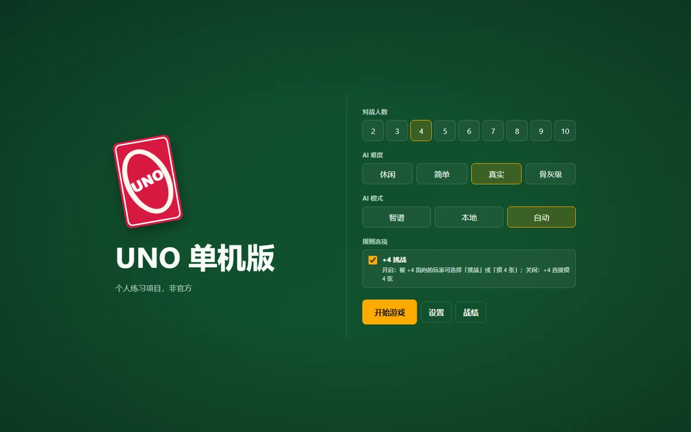
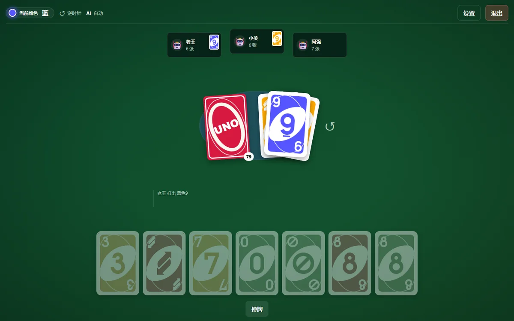
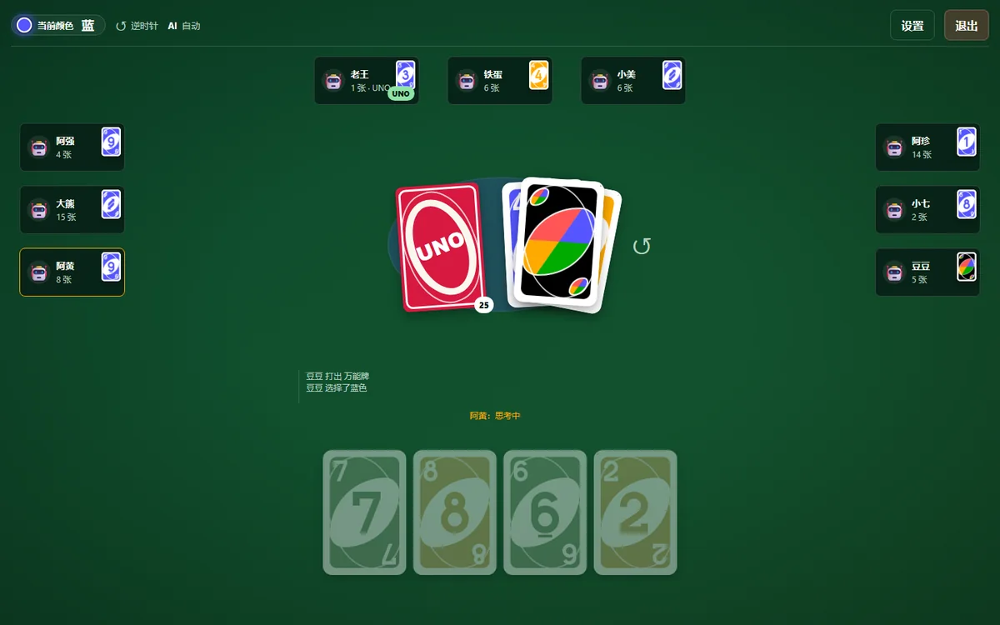
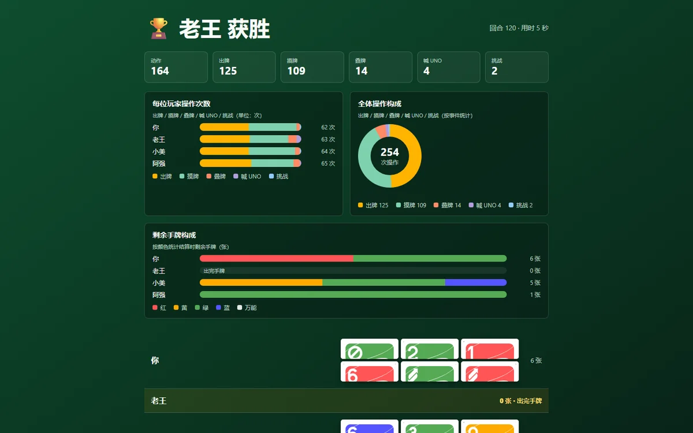
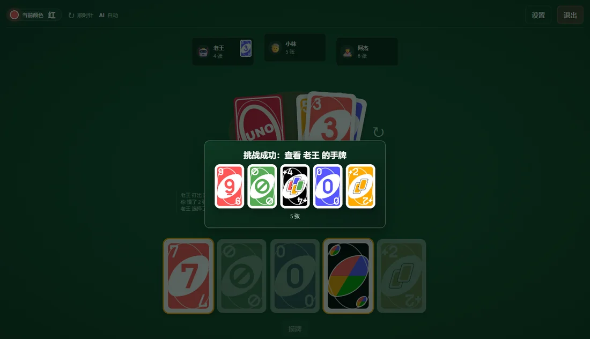
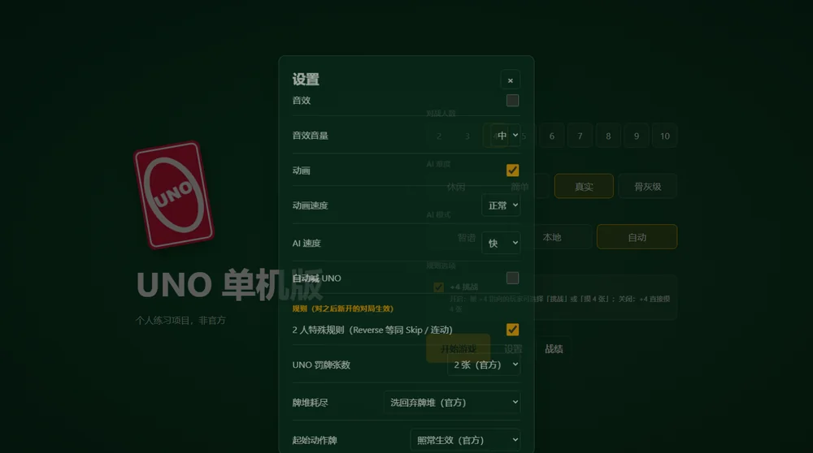
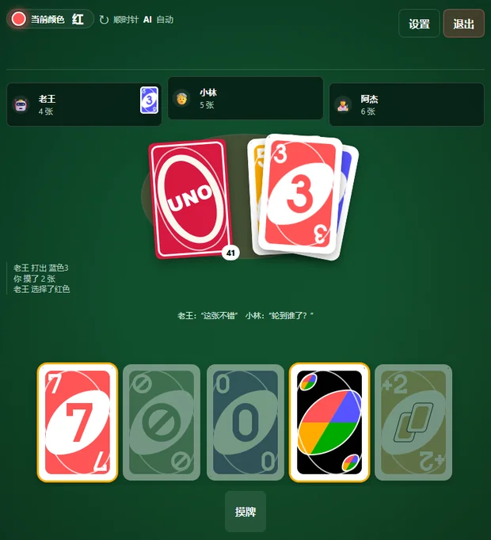

# UNO 单机版 · 本地网页游戏


一个可在本地浏览器里游玩的 **UNO 单机版**：1 名真人 vs 2~9 名 AI，支持四档难度、智谱大模型混合决策、宽松叠牌、+4 挑战、UNO 喊/抓、2 人特殊规则、6~10 人布局、事件动效与音效。前端零构建，未配置任何 API Key 也能完全离线游玩。

> ⚠️ 个人非商业练习项目，与 Mattel 无关。UNO® 是 Mattel 的注册商标。详见文末[免责声明](#免责声明)。

## 目录

- [截图](#截图)
- [功能特性](#功能特性)
- [快速开始](#快速开始)
- [规则说明（与官方原版的差异）](#规则说明与官方原版的差异)
- [AI 模式与智谱配置](#ai-模式与智谱配置)
- [设置项](#设置项)
- [常用命令](#常用命令)
- [测试与质量](#测试与质量)
- [技术架构](#技术架构)
- [目录结构](#目录结构)
- [文档](#文档)
- [常见问题](#常见问题)
- [已知限制与路线图](#已知限制与路线图)
- [免责声明](#免责声明)

## 截图

| 大厅 | 4 人对局 |
| --- | --- |
|  |  |

| 10 人对局（真实引擎模式） | 结算页（操作统计图表，无分数） |
| --- | --- |
|  |  |

| 挑战时查看对方手牌 | 设置页（规则 / 动效 / 音效） |
| --- | --- |
|  |  |

<p align="center">
  
</p>

## 功能特性

- **完整 UNO 规则引擎**：标准 108 张牌、数字/动作牌、颜色/数字/图案匹配、跳过/反转/+2、Wild/+4、+4 挑战、UNO 喊与抓、牌堆耗尽与结算，规则由纯函数 reducer 驱动（可复现 seed）。
- **1 真人 vs 2~9 AI**：大厅可选 2~10 人、四档难度（休闲 / 简单 / 真实 / 骨灰级）、AI 模式（智谱 / 本地 / 自动）。
- **宽松叠牌**：+2 / +4 任意互叠，累计摸牌数；叠牌可选弃权；最后一张叠牌出完立即获胜。
- **+4 挑战**：接受摸 4 张或挑战查看手牌；人类挑战 AI 时展示对方完整手牌 2.6 秒，AI 挑战人类只提示；AI 允许诈唬。
- **UNO 窗口**：剩 1 张时大号「UNO!」单击即喊；忘喊可被其他玩家抓（罚 2 张，可配置）；多人抓按座位顺序只罚一次。
- **2 人特殊规则**：Reverse=Skip、Skip/动作牌连动；可在设置页关闭。
- **6~10 人真实对局**：座位不重叠、1440/1024/760 宽无横向溢出。
- **智谱混合 AI**：本地候选 → 智谱决策 → JSON 校验 → 失败/超时/限流自动降级本地；AI 决策在动画期间预取，状态栏显示最近模型与耗时。
- **动效与音效**：发牌/出牌/摸牌/跳过/反转/叠牌/挑战/UNO/结算彩带等 15 类事件动效；WebAudio 合成 16 类音效；均可关闭，支持系统「减少动态效果」。
- **操作与界面**：点手牌出牌、事件流、当前颜色/方向提示、AI 台词气泡、结算操作统计图表（**不含任何分数计算**）、再来一局/回大厅。
- **本地设置与战绩**：设置、规则项、对局数/胜场保存在 `localStorage`；刷新页面会中断对局（无快照恢复）。
- **零前端构建**：`apps/web` 为原生 HTML/CSS/JS；TS 引擎/AI 由脚本打包为浏览器 ESM，仓库内已提交产物。

## 快速开始

### 环境要求

- Windows 10/11（其他系统未验证，但 Node 部分跨平台）
- Node.js **≥ 22**（开发机 26.7）、npm ≥ 11
- 最新版 Chrome / Edge
- 联网仅在首次 `npm install` 和启用智谱 AI 时需要；本地 AI 完全离线可用

### 安装与启动

```bash
npm install
# 可选：启用智谱 AI（不配置也能玩，自动使用本地 AI）
# Windows: copy .env.example .env   macOS/Linux: cp .env.example .env
# 然后编辑 .env，填入 ZHIPU_API_KEY

npm run dev
# 打开 http://localhost:3000
```

Windows 也可以直接双击 **`启动服务.bat`**（首次运行会自动 `npm install`）。

> 修改 `apps/web` 静态资源后浏览器 `Ctrl+F5` 强刷；修改 `packages/game-core` / `packages/ai` 后必须执行 `npm run build:web-engine`（`npm run dev` 启动前会自动重建）。

## 规则说明（与官方原版的差异）

本作以原版 UNO 为基准，但有几处**有意为之**的规则差异，均可在设置页或大厅调整（默认值保持官方口径）：

| 项目 | 本作默认 | 说明 |
| --- | --- | --- |
| 叠牌 | **宽松叠牌** | +2 / +4 可任意互叠（不看颜色），累计摸牌；叠牌链中的 +4 不开放挑战（为兼容叠加的明确规则决定） |
| 主动摸牌 | **摸到能打出的牌为止** | 一次摸牌可能摸多张，过程牌进手牌；停下的牌只能打出或结束回合（官方为摸 1 张） |
| 起手动作牌 | 照常生效 | 可切「忽略动作牌，继续翻牌」 |
| 牌堆耗尽 | 洗回弃牌堆 | 可切「耗尽即结束（手牌最少者胜）」，并列最少为平局 |
| +4 判定 | 经典口径 | 手上有当前颜色牌时出 +4 属违规；可后续扩展「Wild 也算匹配」 |
| 2 人规则 | 开启 | Reverse 等同 Skip、连动；可在设置页关闭 |
| UNO 罚牌 | 2 张 | 设置页可选 1/2/3 张 |
| +4 挑战 | 开启 | 大厅可关闭；关闭后 +4 直接摸 4 张 |
| 计分 | **无分数** | 结算页只展示最终结算与操作统计图表（出牌/摸牌/叠牌/喊 UNO/挑战、剩余手牌构成） |

完整规则规格见 [`docs/开发计划.md`](docs/开发计划.md) 第 4 章。

## AI 模式与智谱配置

| 模式 | 行为 |
| --- | --- |
| 智谱 | AI 回合优先调用服务端代理的智谱 API（本地构造候选 → 大模型选择 → 合法性校验）；失败/超时/限流自动降级本地 AI |
| 本地 | 完全离线，启发式 AI（记牌、叠牌、挑战/诈唬策略），单次决策微秒级 |
| 自动 | 有可用 Key 时优先智谱，否则自动使用本地 |

智谱相关环境变量（`.env`，Key 只在服务端读取，**不会**进入前端代码或网络请求）：

| 变量 | 说明 | 默认 |
| --- | --- | --- |
| `ZHIPU_API_KEY` | 智谱开放平台 API Key（[获取地址](https://bigmodel.cn/usercenter/proj-mgmt/apikeys)） | 空（仅本地 AI） |
| `ZHIPU_BASE_URL` | API Base URL | `https://open.bigmodel.cn/api/paas/v4` |
| `ZHIPU_MODEL` | 首选模型 | `glm-4.7-flash`（免费） |
| `ZHIPU_FALLBACK_MODELS` | 失败/下线时自动切换的备用模型（逗号分隔） | `glm-4.5-flash,glm-4-flash` |
| `AI_DECISION_TIMEOUT_MS` | 单次决策超时（毫秒），超时降级本地 | `6000` |
| `PORT` | 本地服务端口（页面与 API 共用） | `3000` |

> **关于智谱模式偏慢**：`glm-4.7-flash` 是思考型模型，单次决策实测约 3~4 秒（真实/骨灰级每个 AI 回合都调用，休闲 30% / 简单 60%）。本作已把智谱请求**提前到上一步动画期间预取**，并可在状态栏悬停查看最近模型与耗时；想要即时响应可在设置/大厅切换「本地」模式，或调低 `AI_DECISION_TIMEOUT_MS` 以更快回退。

## 设置项

设置保存在浏览器 `localStorage`（`uno:settings`），规则项仅对**之后新开**的对局生效：

- 通用：音效、音效音量、动画、动画速度（正常/快速）、AI 速度、自动喊 UNO、AI 闲聊、提示条
- 规则：2 人特殊规则、UNO 罚牌张数、牌堆耗尽策略、起始动作牌处理
- 大厅选项：对战人数、AI 难度、AI 模式、「+4 挑战」开关
- 本地战绩：仅记录对局数与胜场（`uno:stats`），不涉及任何分数

## 常用命令

| 命令 | 作用 |
| --- | --- |
| `npm run dev` | 启动本地服务（开发模式，自动重建浏览器引擎包）→ <http://localhost:3000> |
| `npm start` | 启动本地服务（不监听文件变化） |
| `npm test` | 单元测试（24 文件 / 281 用例） |
| `npm run typecheck` | TypeScript 类型检查 |
| `npm run lint` | ESLint 检查 |
| `npm run build:web-engine` | 把 TS 引擎 + AI 打包成浏览器 ESM（`apps/web/js/vendor/uno-engine.js`） |
| `npm run verify:ui` | 浏览器自动验收（102 项，无头 Chrome + CDP，需服务已启动） |
| `npm run selfplay` | AI 自对弈基准（难度单调性 / 混战排名 / 非法动作数） |
| `npm run profile:ai` | 各难度 AI 打牌实测 |
| `npm run smoke:ai` | 智谱连通性冒烟（需 Key） |
| `npm run demo:turn -- --players 4 --seed m17-demo` | 命令行整局回放 |
| `npm run demo:deal -- --players 4 --seed hello` | 命令行发牌演示 |
| `npm run process:cards` | 重新处理 `research/cards` 原始卡面 |

## 测试与质量

| 项目 | 当前结果 |
| --- | --- |
| `npm test` | 24 文件 / 281 用例全部通过（引擎规则、公开视图隐藏信息、结算统计、AI 自对弈等） |
| `npm run typecheck` / `npm run lint` | 0 错误 |
| `npm run verify:ui` | 102 / 102 通过（3 局完整真实对局 + 6/10 人布局轮转 + 挑战手牌 + 抓 UNO + 规则设置 + 动效/音效/响应式 + 控制台/网络/隐藏信息） |
| `npm run selfplay` | 700 局通过（非法动作 0、异常 0；难度胜率单调、混战排名单调） |

浏览器验收报告与截图：`review-assets/ui-m32-verify.md` 与 `review-assets/ui-m32-*.png`。

## 技术架构

```
浏览器（原生 HTML/CSS/JS，零构建）
  ├─ UI：大厅 / 牌桌 / 手牌 / 事件动画 / 结算图表（apps/web）
  ├─ engineMode：对局调度、AI 决策、UNO 窗口、台词、动效事件队列
  └─ uno-engine.js：打包后的规则引擎 + 本地 AI（ESM）
本地服务（Node/Express，apps/server）
  ├─ 静态托管前端
  └─ /api/health、/api/config、/api/ai/decide（智谱代理，Key 只在服务端）
规则与 AI（TypeScript，packages/）
  ├─ game-core：纯函数 reducer（applyAction(state, action) → { state, events }），可复现 seed
  └─ ai：候选生成 / 特征评分 / 记牌 / 四档难度 / 自对弈
```

- 引擎是 UI 的唯一数据出口：`public-view.ts` 负责隐藏信息过滤（他人手牌、牌面、+4 判定信息、挑战查看的手牌等）。
- 前端 UI 只消费 `window.UnoApp` 契约（`render` / `playEvents` / `setActionHandler` / …），事件队列串行播放动画并锁输入。
- 无数据库、无账号、无遥测；所有状态在内存与 `localStorage`。

## 目录结构

```
uno/
├─ apps/
│  ├─ web/                    # 前端（原生 HTML/CSS/JS，零构建）
│  │  ├─ js/engine/           # 引擎模式控制器（对局/AI/UNO 窗口/动效队列）
│  │  ├─ js/ui/               # 界面渲染
│  │  ├─ js/animation/        # 事件动效与队列
│  │  ├─ js/audio/            # WebAudio 合成音效
│  │  ├─ cards/               # 54 张处理后的卡面
│  │  └─ js/vendor/           # 自动生成的浏览器引擎 ESM（勿手改）
│  └─ server/                 # 本地 Express 服务（静态托管 + 智谱代理）
├─ packages/
│  ├─ game-core/              # 规则引擎（纯函数 reducer + 公开视图 + 结算）
│  └─ ai/                     # 本地启发式 AI（四档难度 + 自对弈）
├─ scripts/                   # 自对弈 / 浏览器验收 / 打包 / 卡面处理等脚本
├─ docs/                      # 项目文档与 README 截图（见 docs/README.md）
├─ review-assets/             # 浏览器验收报告与截图（verify:ui 产物）
├─ research/                  # 原始卡面素材与来源说明（见 research/README.md）
├─ .github/workflows/ci.yml   # GitHub Actions：typecheck / lint / test
├─ README.md
├─ 启动服务.bat                # Windows 双击启动
└─ package.json
```

## 文档

| 文档 | 内容 |
| --- | --- |
| [`docs/开发计划.md`](docs/开发计划.md) | 需求、规则规格书、技术架构、里程碑、测试计划 |
| [`docs/开发进度.md`](docs/开发进度.md) | 各模块进度与验证记录（含 M0~M6） |
| [`docs/开发约定.md`](docs/开发约定.md) | 开发汇报与协作约定 |
| [`docs/UI开发提示词.md`](docs/UI开发提示词.md) | UI ↔ 引擎契约（冻结）、视觉规范、分阶段提示词 |
| [`docs/UI验收报告.md`](docs/UI验收报告.md) | UI 各阶段验收报告 |
| [`docs/交接文档-2026-10-18.md`](docs/交接文档-2026-10-18.md) | 当前状态、关键约定、坑位与 M7 待办 |
| [`docs/README.md`](docs/README.md) | 文档索引与阅读顺序 |

## 常见问题

| 现象 | 解决 |
| --- | --- |
| 打开 <http://localhost:3000> 无页面 | 本地服务没启动：`npm run dev` 或双击 `启动服务.bat`，看到 `[uno-server] 已启动` 后刷新 |
| 提示 `EADDRINUSE` | 端口被占用：改 `.env` 的 `PORT`，或关闭占用 3000 端口的程序 |
| AI 不动 / 页面报旧版本 | `Ctrl+F5` 强刷；确认 `apps/web/js/vendor/uno-engine.js` 存在，或重新 `npm run dev` |
| 智谱模式 AI 反应慢 | 免费思考型模型单次约 3~4s；可切「本地」AI、选休闲/简单难度或调低 `AI_DECISION_TIMEOUT_MS` |
| 智谱报错 / 显示「本地·降级」 | 检查 `.env` 的 Key、网络与额度；失败会自动降级本地 AI，不影响对局 |
| 想回到纯 UI 演示模式 | 打开 `http://localhost:3000/?mock=1`（开发工具条可切换 mock 局面） |
| 刷新页面后对局消失 | 当前未实现对局快照恢复（P2），刷新会中断对局 |
| 端口 / Key 配置后不生效 | `.env` 改动需重启服务 |

## 已知限制与路线图

**已知限制**

- 刷新中断对局（无快照恢复）；无联机对战、无账号系统。
- 移动端仅基础响应式（760/1024 断点），未做真机验收；桌面优先。
- 音效为 WebAudio 实时合成（无外部音频素材）；动效为 CSS/Web Animations 轻量实现。
- M6-03（AI 台词人设库）与 M6-04（战绩统计页/结算统计）按项目负责人要求未开发；结算页不含任何分数。
- `wild4Legality`（+4 判定含 Wild）未暴露到设置页，仅引擎配置与单测覆盖。
- 未附开源许可证（个人学习项目）；第三方素材来源见 `research/README.md`。

**路线图**

- M7：发布收尾——E2E 固化、性能报告、一键启动/全新环境验证、README/人工验收清单、可选桌面打包。
- 可选：对局快照恢复、移动端适配、音效素材替换、GitHub Actions 浏览器验收。

## 免责声明

- 本项目为**个人非商业学习项目**，与 Mattel / UNO 官方无任何关联；UNO® 是 Mattel 的注册商标。
- 仓库内卡面素材来自 CC0 资源（见 [`research/README.md`](research/README.md)），仅用于个人学习演示；如公开传播/商用请自行评估商标与版权风险。
- 请勿将本项目用于商业用途或对外提供 UNO 游戏服务。
