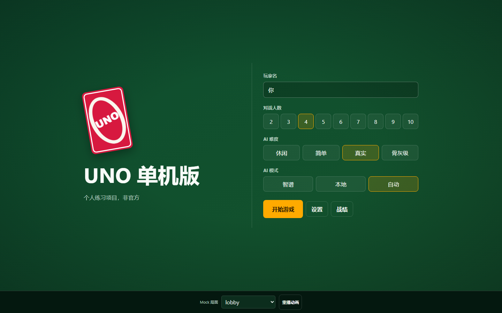
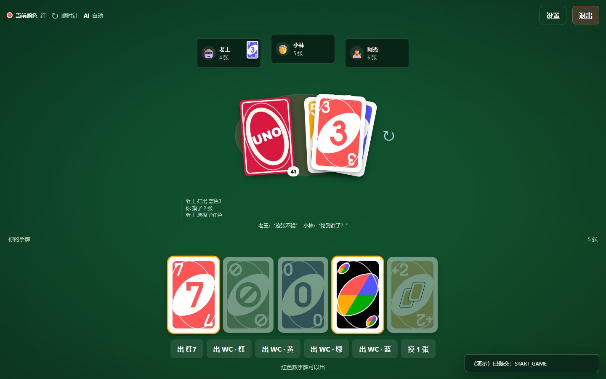
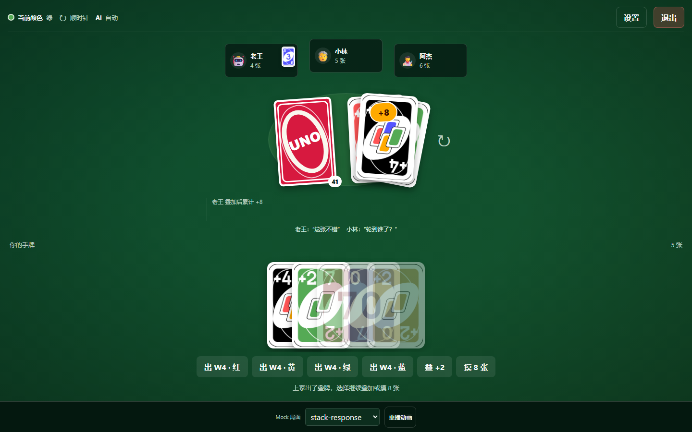
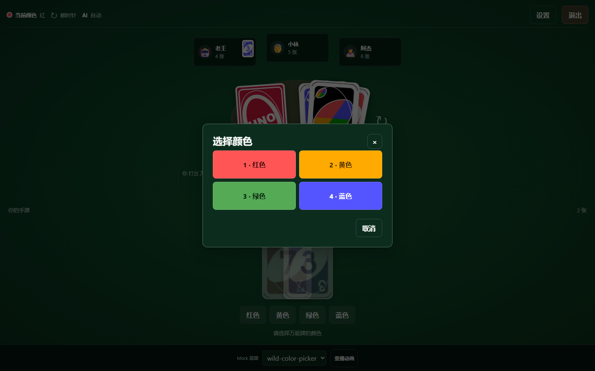
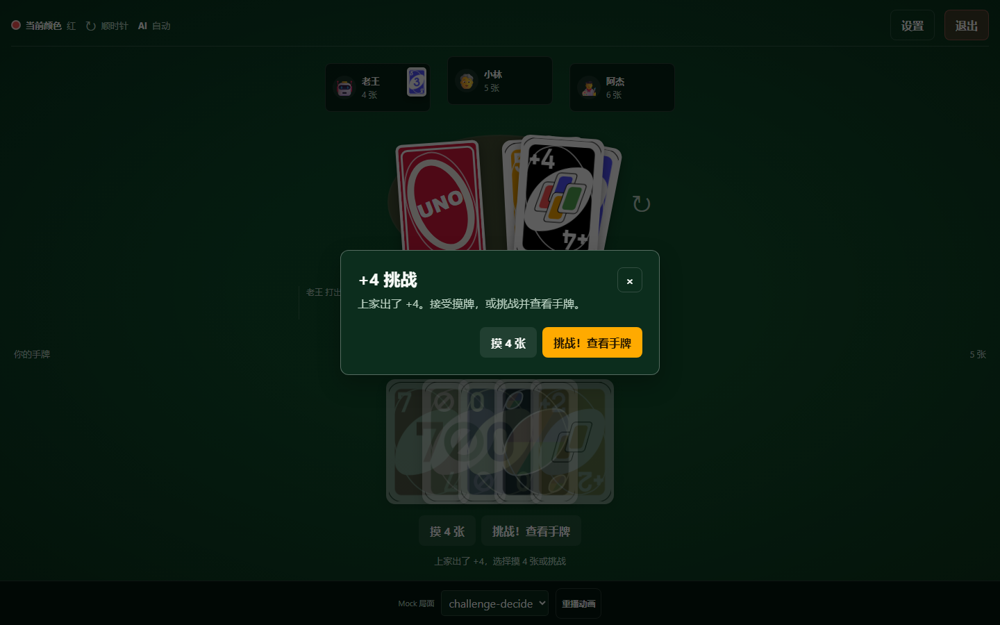
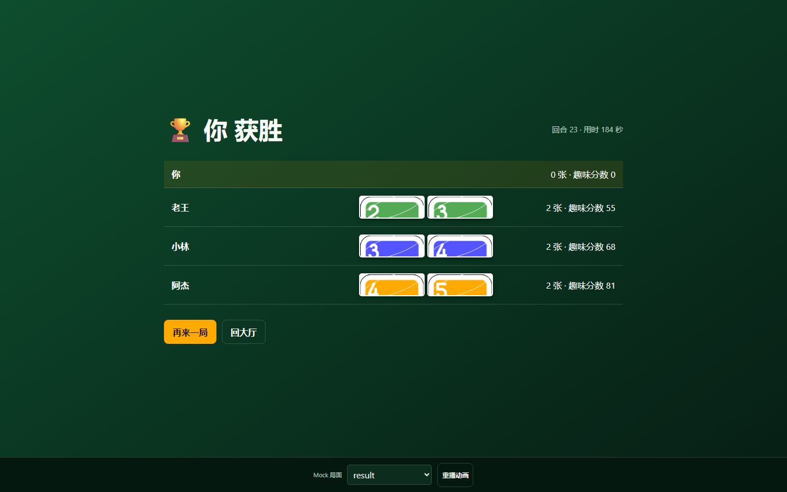
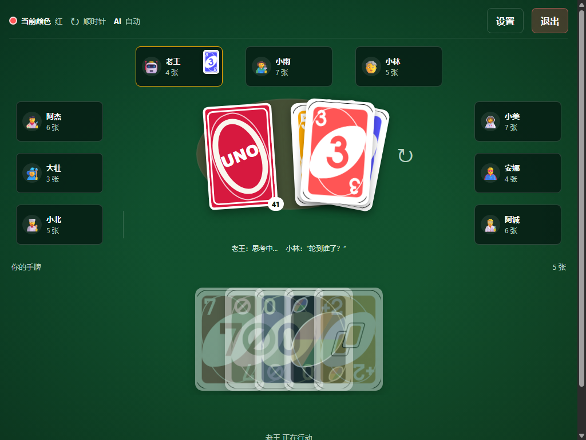

# UI 第一阶段验收报告（2026-10-17）

> 验收对象：外部 Codex 交付的 `apps/web/` 静态 UI 框架（mock 驱动，22 个文件 + 54 张卡面）
> 验收依据：`UI开发提示词.md` 第 1 节（契约）、第 3 节（第一阶段提示词与自检清单）、第 6 节（验收清单）
> 验收方式：静态代码审查（只读）+ 本地服务资源检查 + 无头 Chrome 真实渲染/交互自动化 + 关键局面截图人工核对
> **结论：通过（有保留）** —— 无阻塞问题（P0=0）；契约、DOM 锚点、全局 API、11 种 mock 局面、主要交互均达标。
> **2026-10-17 更新：A 项修复已完成**（6 项建议项 + 2 项质量加固 + 默认入口可点击开始），详见第七节；剩余打磨项见第二节。

---

## 一、验收结果总览

| 验收项（对应第 6 节清单） | 结果 | 证据 |
|------|------|------|
| 打开即见大厅、无报错 | ✅ 符合 | 无头浏览器加载后只有大厅可见；无 JS 异常/报错 |
| 大厅可设置人数 2~10、四档难度、三种 AI 模式，点开始进入牌桌 | ✅ 符合（mock 模式） | 人数按钮 2~10 共 9 个、难度 4 个、模式 3 个；提交后进入牌桌、手牌 5 张 |
| 2 / 4 / 10 人布局，1024~1920 无横向滚动、无重叠 | ✅ 符合 | 1024/1440/1920 三档实测：`scrollWidth==clientWidth`；9 个对手座位无两两重叠；仅 1024×768 底部提示条超出 12px（见 P2-6） |
| 卡面正确显示（R7/W4/WC/YA2），失败有 CSS 兜底 | ✅ 符合 | 全部 mock 局面 `failedImgs=0`；54 种面/108 张卡面文件 0 缺失；代码有 `error` → 色块兜底（hand.js:9） |
| 10 种 mock 局面工具条切换、`?mock=1` 可用 | ✅ 符合 | 工具条 11 个选项（含 two-players）实测切换正常；`?mock=1` 显示工具条 |
| 手牌可出高亮 / 不可出压暗 / 刚抽标记 / 悬停放大 | ✅ 符合（已修复） | 非法牌压暗 + 刚抽黄色标记 + 悬停放大；可出牌已加金色描边/光环（`cards.css`），截图见第七节 |
| wild/wild4 四色选择；叠牌「摸 X 张」；+4 挑战弹窗 | ✅ 符合 | 选色弹窗 4 色 + 数字键 1-4；叠牌 mock 徽标 `+8`、按钮「摸 8 张」；挑战弹窗「摸 4 张 / 挑战！查看手牌」 |
| UNO 按钮 / 抓他按钮显示（mock 点击有 console.log + toast） | ✅ 符合 | UNO!、抓他！按钮与对应弹窗均出现；点击后 toast「已提交：…」+ 控制台 `[UNO mock action]` |
| 结算页数据完整，再来一局/回大厅可点击 | ✅ 符合 | 胜者/剩余手牌缩略/趣味分数/回合/用时齐全；RESTART→牌桌、BACK_TO_LOBBY→大厅实测通过 |
| 键盘可用（Tab 聚焦、Esc 关弹窗、数字键选色）；焦点管理 | ✅ 符合（Enter 待人工确认） | 弹窗内 Tab/Shift+Tab 焦点循环正常；Esc 关闭并归还焦点；数字键 1-4 选色实测生效 |
| 无外部网络请求；无框架/构建依赖；window 仅 UnoApp | ✅ 符合 | 61 次请求全部同源 localhost:3000；无 fetch/XHR/WebSocket/外链字体；`window.` 赋值仅 UnoApp；无 innerHTML/XSS 隐患 |
| README-UI.md 含预览方法、文件说明、mock 切换方式 | ✅ 符合 | README-UI.md 内容完整且与实际行为一致 |

**契约/工程项（静态审查）**：14 个 JS + 5 个 CSS + index.html + README-UI.md + card-back.svg 与规格文件结构完全一致；第 1 节 DOM 契约锚点全部存在且名称正确；`window.UnoApp` 恰好 5 个 API；14 类 UiAction 均有处理通路；`STACK_DECLINE` 的 label 正确体现 `table.stack.total`；UI 内无游戏规则计算，人类操作只经 actionHandler。

---

## 二、问题清单（按严重度）

**P0（阻塞验收）：0 项。**

### P2（应修，不阻塞验收）

| # | 问题 | 证据 | 建议 |
|---|------|------|------|
| P2-1 | 合法手牌没有正向高亮，只靠"非法牌压暗"反衬 | `styles/cards.css:21`（`.is-legal` 仅 `cursor`），对比 `:22` 的 `.is-illegal` | ✅ 已修复：金色描边 + 光环（`cards.css`），运行时实测 `borderColor=rgb(255,170,0)`、`box-shadow` 含金色光环 |
| P2-2 | `wild-color-picker` mock 数据矛盾：弃牌顶仍是默认 R3，同时 WC 还在手牌 | `js/mock/mockView.js:38`（未传 discardTop，使用 `:20` 默认 R3） | ✅ 已修复：弃牌顶改为 WC、WC 移出新手牌，实测 `discardTop=WC`、手牌 [R7,B3] |
| P2-3 | 操作栏为同一张 Wild 生成 4 个「出 WC·色」按钮，点击后仍弹选色，与点手牌路径重复 | `js/ui/hand.js:29-33` | 万能牌在操作栏合并为 1 个入口（或只保留手牌入口） |
| P2-4 | 每次 `render()` 都调用 `closeDialog()`，任意重绘会强制关闭设置/选色弹窗 | `js/ui/render.js:10` | ✅ 已修复：同屏重绘只关"自动弹窗"（选色/挑战），玩家弹窗保留；屏幕切换才全部关闭（`render.js` + `dialogs.js` 的 `closeAutoDialog`） |
| P2-5 | 事件流只对 4 类事件有中文文案，其余（挑战成功/失败、UNO、罚牌、结束等）统一显示「牌桌状态更新」 | `js/ui/table.js:11-18` | ✅ 已修复：契约 19 类事件全部有中文文案（含 ROUND_END 两种原因、挑战、UNO、罚牌） |
| P2-6 | 1024×768 下底部提示条超出视口 12px（需轻微纵向滚动）；mock 工具条整体在首屏外 | 实测 `#hint-bar` bottom=780 > 768；`#dev-toolbar` bottom=856 | 压缩 1024 高度下牌桌纵向间距，或允许提示条随内容滚动（可后置） |
| P2-7 | 浏览器控制台唯一报错：`/favicon.ico` 404（index.html 未声明图标） | 运行时 Log：`Failed to load resource ... /favicon.ico` | ✅ 已修复：`<link rel="icon" href="assets/card-back.svg">`，复测 0 日志错误、0 非 2xx 响应 |
| P2-8 | `.thinking` 动画样式未被使用，AI「思考中…」没有脉冲点 | `js/ui/players.js:19` 生成的节点无 `.thinking` class；`styles/components.css:14-15` 样式空转 | 思考气泡挂 `.thinking` class |
| P2-9 | `UiAction.hint` 未被提示条消费（提示条只按 phase 出文案） | `js/app.js:13-20`、`js/mock/mockView.js:26` | ✅ 已修复：提示条优先显示当前动作的 hint，实测显示「红色数字牌可以出」 |
| P2-10 | 没有任何 mock 局面展示 AI 的「UNO」标记（`oneUno` 参数从未被传入） | `js/mock/mockView.js:15`、`:30-47` | catch-uno 或 normal-play 里给某 AI 加 `saidUno:true` |
| P2-11 | 不带 `?mock=1` 打开（引擎模式）时，大厅点「开始游戏」静默无反馈 | `js/app.js:7`、`:35` | ✅ 已修复（用户报告后修复）：M3-2 前默认 mock 模式，直接打开主地址即可点「开始游戏」；`?mock=0`/`?mode=engine` 保留引擎模式 |

> 另：质量审查发现 **P1 级风险「取消动画会误触 done 回调」**（`js/animation/queue.js`：`cancelEvents()` 复用 `finish()` 会调用上一轮 `playEvents` 的完成回调，引擎接入后可能被"取消"误触发下一步）。**已修复**：取消只清理、不触发 done；实测取消后 done 计数为 0、正常播放 done 计数为 1。

### P3（可后置）

| # | 问题 | 证据 | 建议 |
|---|------|------|------|
| P3-1 | `stats.recordResult` 未被调用，且 `bestScore` 用 `Math.min`（看起来反了）；死代码易误导 | `js/state/stats.js:8-13` | M6 做战绩时再实现并修正语义 |
| P3-2 | `mockView.js` 末尾 `mockAction` 为未使用的死代码 | `js/mock/mockView.js:50` | 删除或接入 |
| P3-3 | `#app` 上 `aria-live="polite"` 覆盖整个应用，读屏器可能反复播报大段内容 | `index.html:15` | 对接时缩小 live region 范围（可后置） |

---

## 三、运行时验收数据（摘要）

- **资源**：`/`、5 个 CSS、14 个 JS、5 张抽样卡面、card-back.svg 均 200；`/nope` 404 JSON 正常。
- **11 种 mock 局面 @1440×900**：全部正常渲染，单屏可见；`failedImgs=0`；无横向溢出；无座位重叠；无元素越界。
- **布局**：2/4/10 人 × 1024/1440/1920 共 9 组，均无横向滚动与重叠；1024×768 仅底部提示条超出 12px。
- **交互 9/9 通过**：出牌、Wild 选色（含数字键）、叠牌弃权（摸 8）、+4 挑战、UNO 喊、抓 UNO、大厅开始、结算再来一局/回大厅、设置保存（localStorage `uno:settings`）。
- **动画**：`playEvents` 播放期间 `#game-screen[aria-busy=true]`、完成后移除并回调；`prefers-reduced-motion: reduce` 时 0ms 直接完成。
- **控制台**：JS 异常 0、console.error 0、warning 0；唯一日志错误是 `/favicon.ico` 404。
- **网络**：61 次请求全部同源；无 CDN/外链/远程字体。

## 四、关键证据截图

| 大厅 | 牌桌（4 人） |
|------|------|
|  |  |

| 叠牌响应（累计 +8） | Wild 选色弹窗 |
|------|------|
|  |  |

| +4 挑战弹窗 | 结算页 |
|------|------|
|  |  |

| 10 人布局（1024×768） |
|------|
|  |

## 五、验收须知与已知限制

1. **预览方式**：服务已在 `http://localhost:3000` 运行，请打开 **http://localhost:3000/?mock=1**。不带 `?mock=1` 时处于"等待引擎接入"的引擎模式，大厅按钮暂不响应（P2-11，属预期，M3-2 接入后可用）。
2. 本阶段是**纯静态 UI**：所有数据来自 mock，点击只产生 toast + console.log，不推进真实对局；真实规则由引擎提供（M3-2 对接）。
3. 动效为第一阶段基础版（事件队列每条 200ms，重播按钮可看），发牌/飞牌/彩带等属第二阶段；卡牌悬停观感、颜色辨识、触屏体验建议人工最终确认。
4. 本报告的问题均未修改代码（验收阶段只读），是否修复、何时修复等你指令。

## 六、建议下一步

- **第一批修复已完成**（见第七节）：6 项"对接前修" + 默认入口可点开始 + 2 项质量加固。
- 之后即可进入 **M3-2 UI 对接引擎**（需要引擎侧补 `getPublicView` / 动作映射 / AI 调度）；也可先按原计划做 **M1-5 +4 挑战** 等规则模块，再统一对接。

## 七、A 项修复记录（2026-10-17）

用户报告"点击开始游戏没有反应"后完成第一批 UI 修复（均在 `apps/web/` 内，未改引擎）：

| 项 | 文件 | 修复内容 | 复测结果 |
|---|---|---|---|
| 开始按钮无反应（P2-11，用户报告） | `js/app.js` | M3-2 前默认 mock 模式；`?mock=0`/`?mode=engine` 保留引擎模式 | 直接打开 `http://localhost:3000/`：mode=mock，点开始进入牌桌（手牌 5、toast「已提交：START_GAME」） |
| 可出牌高亮（P2-1） | `styles/cards.css` | 合法牌金色描边 + 光环，悬停保留 | 实测 `borderColor=rgb(255,170,0)`、金色光环 |
| wild 选色 mock 数据（P2-2） | `js/mock/mockView.js` | 弃牌顶 WC、WC 移出手牌、补 events | `discardTop=WC`，手牌 [R7,B3]，选色弹窗 4 色正常 |
| 弹窗关闭策略（P2-4） | `js/ui/render.js`、`js/ui/dialogs.js` | 同屏重绘只关自动弹窗（选色/挑战）；屏幕切换才全关 | 设置弹窗在重绘/换 mock 后保持；切屏关闭；选色自动弹窗重绘后仍在 |
| 事件流文案（P2-5） | `js/ui/table.js` | 契约 19 类 GameEvent 全部中文文案 | 19 类逐条渲染验证通过 |
| action.hint 消费（P2-9） | `js/app.js` | 提示条优先显示动作 hint | 显示「红色数字牌可以出」 |
| favicon 404（P2-7） | `index.html` | `rel=icon` 指向 `assets/card-back.svg` | 0 日志错误、0 非 2xx 响应 |
| 质量加固：取消动画误触 done（P1） | `js/animation/queue.js` | `cancelEvents()` 只清理不回调；`playEvents` 重入安全 | 取消后 done=0、正常播放 done=1，`aria-busy` 正确清除 |
| 质量加固：战绩写入无兜底（P2） | `js/state/stats.js` | localStorage 写入加 try/catch | — |

**复测（无头 Chrome）**：11 种 mock 全部正常渲染、0 张图片加载失败、横向溢出 0、控制台 0 JS 异常 / 0 日志错误、123 次请求全部同源且无非 2xx；引擎侧 `npm test` 75 用例、`typecheck`、`lint` 均通过。

**修复后预览**：直接打开 `http://localhost:3000/` 即可（建议 Ctrl+F5 强制刷新，避免旧 JS 缓存）。
**剩余打磨项**：P2-3（wild 操作栏按钮合并）、P2-6（1024×768 底部 12px）、P2-8（思考脉冲）、P2-10（AI UNO 标记 mock）、P3×3 —— 不阻塞 M3-2。

## 八、第二轮 UI 调整（用户反馈，2026-10-17）

用户反馈两点："底部常驻显示是什么"、"手牌始终重叠，希望排开、多了折叠、悬停提到最上层"。已调整：

1. **底部信息**：提示条 `#hint-bar` 保留（正式游戏内的操作提示）；Mock 开发工具条改为**默认隐藏**，只有 `?mock=1` 或 `?dev=1` 开发模式才显示；动作 toast 加「（演示）」前缀，接入引擎后由真实对局反馈替代。
2. **手牌排布**：默认**全部排开**（间距 10px、底部对齐）；数量超出容器宽度时**均匀折叠**（每张至少露出 36px，仍放不下则手牌区横向滚动）；鼠标悬停/键盘聚焦时当前牌 **z-index 提到最上层并上浮**（合法牌上浮 + 放大、非法牌也上浮便于查看）。
3. **悬停裁切修复**（用户反馈"上浮后顶部被切"）：`#hand` 顶部留白由 20px 增至 26px，上浮幅度收敛到 -14px + scale 1.05（合法）/ -14px（非法）；矮屏（≤820px 高）自动降到 -12px + scale 1.04，顶部留白 22px。复测：1440 悬停牌顶距容器顶 3px、1024 为 3px、折叠 16 张悬停同样 3px，**裁切量全部为 0**（截图 `review-assets/ui-hand-hover-fixed-1440.png`）。
4. **卡面黑边去除 + 图案居中**（用户反馈"卡牌上这条黑线"、"牌不居中、白边上下不均匀"）：
   - 根因一：卡面 PNG 模板自带 1~2px 黑色描边（原始 CC0 卡牌 SVG 的轮廓线，位于图片最外缘）。
   - 根因二：手牌卡是 `<button>`，去掉旧 4px 边框后浏览器默认按钮边框（2px）露出，内容区变成 116×176（不是 2:3），图片被 `object-fit: cover` 轻微裁切，白边四边不均；素材图案本身也有 1~2px 偏移。
   - 修复：① `scripts/process-cards.py` 新增 `strip_outer_outline`（把外圈描边与抗锯齿像素洗白，不缩放不裁切）和 `center_visual_frame`（按四边白边把图案整体居中），重新生成 54 张 240×360 卡面；② `apps/web/styles/cards.css` 卡牌改为 `border: 0`，图片按 2:3 精确填充 120×180，合法牌高亮改为外圈 3px 金色光环。
   - 复测：54 张素材四边白边均为 **20px（完全一致）**；渲染后按 4 倍截图测量白边 上/下/左/右 = **9.75 CSS px（一致）**、卡牌内中性黑像素 = **0**；`npm test` 75 用例、typecheck、lint 全部通过（截图 `review-assets/ui-card-edge-clean.png`、`ui-normal-play-1440.png`）。

**实测**：1440 宽 5 张 → step=130px（无重叠、总宽 640px）；16 张 1440 宽 → step=84px；1024 宽 → step=55px，均无横向溢出；悬停时重叠区命中元素从右邻牌变为当前牌（`z-index=20`、`translateY(-18px)`）。截图：`review-assets/ui-hand-spread-1440.png`、`ui-hand-folded-1440.png`、`ui-hand-folded-hover-1440.png`。

## 九、用户追加需求：大厅「+4 挑战」勾选项（2026-10-17）

> 需求：+4 挑战在开始游戏前可勾选（默认开启）。属用户明确要求的 UI 迭代，契约 DOM 锚点/`window.UnoApp` API 未改动。

**改动**：`index.html` 大厅「规则选项」区新增 `#challenge-wild4` 勾选框（含说明文案）；`js/ui/lobby.js` 读取/保存本次会话选择，并在 `START_GAME` 的 `config` 中附带 `challengeWild4`；`js/mock/mockView.js` 的 `config` 默认值补 `challengeWild4: true`；`styles/components.css` 新增 `.rule-toggle` 样式；`README-UI.md` 与 `UI开发提示词.md` 第 1 节同步说明该向后兼容扩展。

**无头 Chrome 实测（`review-assets/ui-lobby-challenge-toggle-1440.png`）**：

- 勾选框存在、类型 checkbox、默认 `checked=true`，文案「+4 挑战 / 开启：被 +4 指向的玩家可选择「挑战」或「摸 4 张」；关闭：+4 直接摸 4 张」；
- 默认点击「开始游戏」→ `START_GAME.config.challengeWild4 === true`；取消勾选后再开始 → `false`，同时正常进入 mock 牌桌（手牌 5 张）；
- 1440×900 与 1024×768 下勾选框完整在视口内（1024 时标签底边约 580px）、开始按钮可见、无横向溢出（scrollWidth=clientWidth）；
- 控制台 0 JS 异常、0 错误日志、0 非 2xx 请求；刷新后回到默认勾选（按设计不跨刷新持久化）；
- 既有 mock 局面与交互未回归（M1-5/M1-6 引擎 114 用例、typecheck、lint 全过）。
